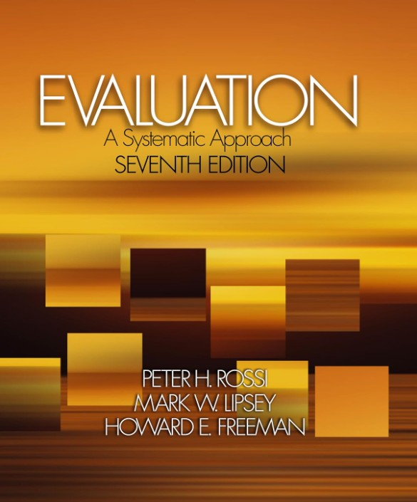
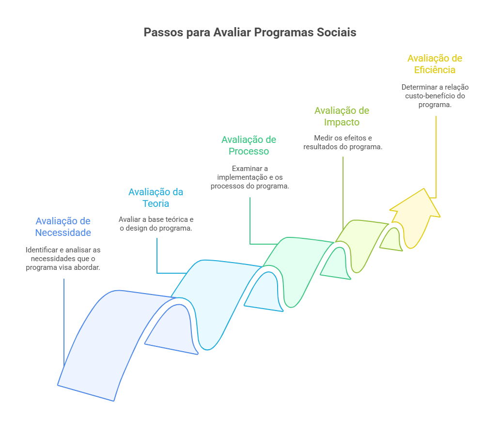

# Visão Geral da Avaliação de Programas Sociais {background-color="#87806b"}

## Livro de Referência da Aula

:::: {.columns}

::: {.column width="50%"}
-	Rossi, P.H.; Lipsey, M.W.; Freeman, H.E.*Evaluation: A Systematic Approach*, Ed. Sage, 7ª ed., 2004
:::

::: {.column width="50%"}
{.lightbox}
:::

::::

# Aspectos gerais da Avaliação {background-color="#4c6073"}

## Avaliação: Aspectos gerais

- Avaliação de programa é a obtenção e interpretação de informações sobre o desempenho e efetividade do programa.
- Quais questões a avaliação deve responder?
- As questões podem ser divididas em 5 grandes áreas, dependendo do aspecto do programa que se quer avaliar:
  - **Avaliação das necessidades**: condições que o programa visa melhorar e justificativa de sua existência.
  - **Avaliação da teoria do programa**: conceituação e desenho lógico do programa.

## Avaliação: Aspectos gerais

- Continuação das áreas de avaliação:
  - **Avaliação do processo do programa**: como ele é operacionalizado, implementado e quais serviços entrega.
  - **Avaliação de impacto**: resultados e impactos do programa.
  - **Avaliação de eficiência**: custos e custos efetividades do programa.

# Avaliando a Necessidade da Política {background-color="#4c6073"}

## Avaliação das Necessidades 

- Um Programa social alivia problemas

:::{.callout-note}
## Exemplo

Um programa de alfabetização de adultos requer que haja uma parte considerável da população adulta analfabeta. 

:::
 
- Deve ser justificada por um problema social persistente
- Analisar a natureza, magnitude e a distribuição do problema social
- Com isso, tem-se a necessidade de intervenções e seu desenho
- É o primeiro passo para planejar um programa novo ou reestruturar antigos

## Avaliação das Necessidades

- Perguntas comuns:
  - Qual a natureza e magnitude do problema a ser estudado?
  - Quais são as características da população em necessidade?
  - Quais são as necessidades da população?
  - Quais serviços são necessários?
  - Quanto serviço é necessário e por quanto tempo?
  - Quais os acordos necessários para que os serviços sejam entregues a população?

# Avaliando a Teoria e Desenho da Política {background-color="#4c6073"}

## Avaliação da Teoria e Desenho 

- Agora temos o problema reconhecido e a necessidade de intervenção.
- A conceituação e o desenho do programa tem que refletir hipóteses válidas sobre a natureza do problema e representar um abordagem factível.
- Todo programa é baseado em um plano que representa a maneira que “supostamente deveria funcionar”.
- Raramente são escritos em detalhes mas é uma conceituação a ser dividida entre os diversos atores.
- O plano do programa representa hipóteses e expectativas de como atingir os objetivos: Teoria do Programa

## Avaliação da Teoria e Desenho

- Se a teoria for defeituosa, não importa quão elegante é o plano ou quão bem feita seja sua apresentação, a intervenção vai falhar...
- A avaliação da teoria foca nas questões de conceitos e desenho do programa, para isso:
    - Descrever detalhadamente e explicitamente a teoria do programa ou modelo lógico: mostrando impacto da teoria, plano de utilização dos serviços, organização do programa
    - Examinar quão razoável, factível, ético e apropriado é a teoria do programa
    - Planejar o uso de serviços, estrutura organizacional, recursos, público-alvo e estratégias de entrega.

## Avaliação da Teoria e Desenho

- Perguntas comuns:
  - Qual o público alvo que deve ser servido?
  - Qual o serviço deve ser provido?
  - Qual o melhor sistema de entrega para esses serviços?
  - Como o programa pode identificar, recrutar e sustentar o público alvo desejado?
  - Como o programa deve ser organizado?
  - Quais os recursos são necessários e apropriados para o programa?

# Avaliando o Processo de Implementação da Política {background-color="#4c6073"}

## Avaliação do Processo 

- Dada uma teoria plausível do programa, ainda é preciso implementa-lo bem.
- É usual encontrar programas que não foram implementados da forma como se planejava.
- Um programa pode ter administração ruim por interferências políticas ou desenhado de maneiras que é impossível executá-lo
- Muitas vezes a pessoa certa não está disponível, infraestrutura é inadequada, falta motivação, conhecimento e treinamento para funcionários envolvidos na intervenção. 
- Os participantes podem não existir no número requerido, não podem ser identificados facilmente ou não estão querendo cooperar.

## Avaliação do Processo

- Avalia a fidelidade e efetividade da implementação de um programa.
- Avalia as atividades e as operações de um programa. Chamada de Avaliação de Processo ou Monitoramento se for uma função contínua.
- É a forma mais frequente de avaliação. É utilizada só ou juntamente com a avaliação de impacto.
- Fornece informações com qualidade de quanto foi cumprido da implementação da proposta
- Em um programa com resultados já conhecidos uma boa implementação pode ser uma forte evidência de que o resultado esperado está sendo alcançado. 

## Avaliação do Processo

- Para programas novos gera informação relevante ou feedbacks para  administradores e interessados.
- A coleta e o relatório de indicadores chaves deve ser institucionalizado em um Sistema de Informação Gerencial (SIG) e realizado de forma rotineira.
- É uma parte indispensável para a avaliação de impacto, pois essa fica incompleta e ambígua se não compreender os serviços e as atividades que produziram o resultado.
- Quando o resultado não é encontrado a avaliação de processo tem papel fundamental indicando se é um problema de implementação ou de teoria do programa
- Se o programa tem efeito ele auxilia a encontrar os canais pelos quais esse efeito ocorreu

## Avaliação do Processo

- Perguntas comuns:
  - Os objetivos administrativos e os serviços estão sendo atendidos ?
  - Os serviços pretendidos estão sendo entregues as pessoas pretendidas?
  - Existem pessoas necessitadas mas não atendidas pelo programa?
  - Uma vez atendido, um número suficientemente grande de beneficiários completam o serviço?
  - Os clientes estão satisfeitos como serviço?
  - As funções administrativas, organizacionais e pessoais estão sendo bem geridas?

# Avaliando o Impacto da Política: Teve Efeito? {background-color="#4c6073"}

## Avaliação de Impacto 

- Quantificar quanto que o programa conseguiu alcançar em termos da melhoria do problema tratado.
- Tenta responder quanto do resultado desejado foi atingido e se existe algum efeito não desejado.
- A dificuldade: o resultado desejado pode ter sido causado por fatores não relacionados ao programa.
- Quer se obter um efeito líquido do programa.
- Para isso tem que estabelecer um desenho capaz de medir o indicador nos que receberam e o que teria acontecido com o indicador se eles não tivessem recebido (contrafactual).
- Essa é a principal dificuldade, encontrar um bom **contrafactual**...

## Avaliação de Impacto

- Dois desafios: quando a avaliação de impacto é necessária e qual o desenho utilizar.
- Avaliação de Impacto é muito demandante em termos de conhecimento, tempo e recurso. Portanto, difícil de se adequar as rotinas operacionais do programa.
- Mesmo sendo necessária, para programas que não estão bem estruturados ou não podem ser adequadamente descritos, a avaliação de impacto torna-se não justificada.
- Em geral utilizadas para programas maduros e estabilizados ou pilotos com modelos e implementação bem estruturadas.   

## Avaliação de Impacto

- Perguntas comuns:
  - As metas de resultados e objetivos estão sendo atingidos?
  - Os serviços tem impacto positivo na população atingida?
  - Os serviços fornecidos tem efeitos adversos sobre a população atingida?
  - Alguns indivíduos se beneficiam mais do serviço do que outros?
  - A situação ou problema que o serviço tinha a intenção de corrigir ficou melhor?

# Avaliando a Eficiência: Vale a Pena? {background-color="#4c6073"}

## Avaliação de Eficiência 

- Encontrar que um programa tem efeito positivo sobre o problema alvo é insuficiente para avaliar o valor social do programa.
- Recursos para programas sociais são limitados, então os seus resultados devem ser confrontados com seus custos. 
- Alguns programas podem não ser atrativos devido ao seu custo alto em relação ao seu benefício se comparado a outros programas. 
- A Avaliação de Eficiência considera a relação entre o custo do programa e a efetividade. Pode ser análise de custo-benefício ou análise de custo-efetividade. 

## Avaliação de Eficiência

- Dificuldade: requer que façamos hipóteses sobre o valor monetário das atividades relacionadas ao programa e colocar valor monetário nos benefícios do programa.
- Apesar disso, é essencial para uma melhor alocação de recursos entre os programas  e identificar aquele que possui maior beneficio com a mesma quantidade de recursos. 

## Avaliação de Eficiência

- Perguntas comuns:
  - Os recursos estão sendo utilizados adequadamente?
  - Os custos são razoáveis em relação a magnitude do benefício?
  - Será que outra abordagem poderia trazer benefícios equivalentes e um menor custo?
  - Em geral, também utilizadas para programas maduros e estabilizados ou pilotos com modelos e implementação bem estruturadas.   
  - Essa análise é dependente da Avaliação de Impacto e de Processo. Programa deve ser bem implementado e produzir o impacto desejado para depois se fazer a análise de eficiência

# Conclusão {background-color="#4c6073"}

---

{.lightbox fig-align="center" width=85%}