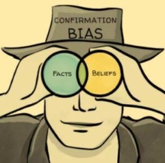

Uma análise pode estar tecnicamente correta e, ainda assim, produzir uma conclusão inadequada. Isso acontece quando afirmamos mais do que os dados e o desenho da investigação permitem sustentar.

Neste capítulo, distinguiremos quatro níveis de investigação — **descrição, associação, explicação e causalidade** — e aprenderemos a comunicar os resultados com uma linguagem compatível com a evidência produzida.

O objetivo não é ensinar econometria ou métodos formais de identificação causal. Antes de escolher modelos, precisamos compreender **qual pergunta estamos fazendo e que tipo de conclusão pretendemos alcançar**.

::: {.callout-note title="Objetivos do capítulo"}

Ao final deste capítulo, você deverá ser capaz de:

- diferenciar descrição, associação, explicação e causalidade;
- reconhecer que uma associação não demonstra, por si só, uma relação causal;
- identificar explicações alternativas para um resultado observado;
- adequar a linguagem da conclusão à evidência disponível;
- classificar a pergunta inicial do tutorial quanto ao tipo de conclusão pretendida.

:::

## Da pergunta ao tipo de conclusão

Perguntas diferentes exigem evidências diferentes. Descrever a evolução da inflação não é o mesmo que explicar por que ela aumentou. Comparar os rendimentos de dois grupos não equivale a demonstrar que uma característica causou a diferença.

```{mermaid}
%%| fig-align: center
%%| fig-alt: "Progressão entre descrição, associação, explicação e causalidade, com aumento das exigências de evidência"

flowchart LR
    A["Descrição<br/>O que acontece?"] --> B["Associação<br/>O que varia junto?"]
    B --> C["Explicação<br/>Por que poderia acontecer?"]
    C --> D["Causalidade<br/>O que aconteceria se X mudasse?"]

    classDef etapa fill:#E4F1E6,stroke:#2F5D3A,stroke-width:2px,color:#183A22;
    class A,B,C,D etapa;
    linkStyle default stroke:#2F5D3A,stroke-width:2px;
```

O diagrama representa uma progressão na **exigência da evidência**, e não uma escala de importância. Uma boa análise descritiva pode ser mais útil e confiável do que uma tentativa frágil de estimar causalidade.

::: {.callout-important title="A pergunta mais sofisticada não é necessariamente a melhor"}

Para um tutorial introdutório, responder com clareza a uma pergunta descritiva relevante pode exigir importação, limpeza, transformação, construção de variáveis, visualização e interpretação cuidadosa.

Não é necessário formular uma pergunta causal para produzir um trabalho economicamente interessante.

:::

## Descrição: o que está acontecendo?

Uma pergunta **descritiva** procura caracterizar um fenômeno. Ela pode investigar níveis, distribuições, diferenças ou mudanças ao longo do tempo.

Exemplos:

- como a taxa de informalidade evoluiu nas regiões brasileiras?
- como os componentes da inflação contribuíram para o índice agregado?
- como retorno e volatilidade se comportaram entre diferentes ativos?

Para responder, podemos calcular proporções, médias, quantis, taxas de crescimento ou outras medidas e apresentá-las por meio de tabelas e gráficos.

Descrição não significa ausência de análise. Uma descrição rigorosa exige decisões sobre conceitos, recortes, variáveis, agrupamentos e medidas. Essas decisões determinam o que será revelado — e também o que permanecerá oculto.

::: {.callout-warning title="Descrever não é apenas mostrar números"}

Uma tabela não fala sozinha. A interpretação precisa indicar:

- qual padrão foi observado;
- em quais grupos, lugares ou períodos;
- qual é a magnitude da diferença ou mudança;
- quais limites precisam ser considerados.

:::

## Associação: o que varia conjuntamente?

Duas variáveis apresentam **associação** quando seus valores variam de maneira relacionada. Podemos observar, por exemplo, que:

- pessoas com maior escolaridade apresentam, em média, rendimentos maiores;
- períodos com juros elevados coincidem com determinadas trajetórias da atividade econômica;
- ativos com maior retorno médio também podem apresentar maior volatilidade.

A associação pode ser positiva, negativa ou não apresentar um padrão evidente. Ela também pode mudar entre grupos e períodos.

Contudo, observar que duas variáveis caminham juntas não demonstra que uma delas provoca a outra.

::: {.callout-note title="Associação é uma conclusão válida"}

Dizer que duas variáveis estão associadas não é uma conclusão “menor”. É uma afirmação informativa e compatível com muitos tipos de dados.

O problema surge quando substituímos, sem justificativa, “está associado a” por “causa”, “determina”, “produz” ou “gera”.

:::

## Explicação: por que o padrão pode ocorrer?

Uma **explicação** propõe um mecanismo capaz de dar sentido aos fatos observados. Ela conecta a evidência a uma ideia sobre como indivíduos, empresas, mercados ou instituições se comportam.

Suponha que encontremos menor participação no mercado de trabalho entre mulheres com filhos pequenos. Algumas explicações possíveis seriam:

- maior necessidade de cuidados no domicílio;
- custo ou indisponibilidade de serviços de cuidado;
- diferenças na composição familiar;
- condições locais do mercado de trabalho;
- normas sociais e divisão desigual do trabalho doméstico.

Os dados podem ser consistentes com uma ou mais dessas explicações, mas uma descrição isolada dificilmente permite escolher definitivamente entre elas.

Autor, Levy e Murnane [@autorlevymurnane2003] oferecem um exemplo econômico importante. Em vez de apenas registrar que o uso de computadores cresceu junto com a demanda por trabalhadores qualificados, os autores perguntam quais tarefas a tecnologia substitui ou complementa. A distinção entre tarefas rotineiras e não rotineiras propõe um mecanismo que gera novas previsões a serem confrontadas com os dados.

::: {.callout-tip title="Uma explicação precisa gerar implicações observáveis"}

Pergunte: **se esta explicação estiver correta, que outros padrões esperaríamos encontrar?**

Uma história que se adapta a qualquer resultado é difícil de confrontar com a evidência. Uma explicação útil ajuda a definir quais observações poderiam fortalecê-la ou enfraquecê-la.

:::

## Causalidade: o que aconteceria se algo mudasse?

Uma pergunta **causal** procura compreender o efeito de uma mudança em determinado fator sobre um resultado.

Exemplos:

- qual é o efeito da oferta de creches sobre a participação das mães no mercado de trabalho?
- qual é o efeito de uma alteração na taxa de juros sobre a atividade econômica?
- como uma mudança regulatória afeta a liquidez dos ativos?

A dificuldade é que observamos o que aconteceu, mas não observamos simultaneamente o que teria acontecido com a mesma unidade, no mesmo momento, se a condição fosse diferente. Essa situação alternativa é chamada de **contrafactual**.

Para sustentar uma conclusão causal, precisamos construir uma comparação que represente adequadamente esse contrafactual. Essa tarefa exige hipóteses adicionais e um desenho de investigação apropriado.

### Por que a associação pode enganar?

Três problemas aparecem com frequência.

::::: columns
::: {.column width="75%"}

Ao interpretar uma associação, existe ainda um risco humano importante: procurar apenas argumentos que confirmem aquilo em que já acreditávamos. Por isso, uma boa análise deve considerar explicações concorrentes e perguntar que evidência poderia contrariar nossa interpretação preferida.

:::

::: {.column width="25%"}

{.lightbox fig-alt="Ilustração de uma pessoa usando binóculos em que fatos e crenças aparecem sobrepostos" width="90%"}

:::
:::::

```{mermaid}
%%| fig-align: center
%%| fig-alt: "Três motivos pelos quais uma associação observada pode não representar uma relação causal: causalidade reversa, fatores omitidos e seleção"

flowchart TB
    A["Associação observada entre X e Y"]
    A --> B["Causalidade reversa<br/>Y também pode afetar X"]
    A --> C["Fator omitido<br/>Z pode afetar X e Y"]
    A --> D["Seleção<br/>os grupos já eram diferentes"]

    classDef central fill:#E4F1E6,stroke:#2F5D3A,stroke-width:2px,color:#183A22;
    classDef alerta fill:#FFF3CD,stroke:#8A6426,stroke-width:2px,color:#4A3512;
    class A central;
    class B,C,D alerta;
    linkStyle default stroke:#2F5D3A,stroke-width:2px;
```

#### Causalidade reversa

A direção da relação pode ser diferente da que imaginamos. Empresas mais produtivas podem adotar mais tecnologia, ao mesmo tempo que a tecnologia pode elevar a produtividade.

#### Fatores omitidos

Uma terceira característica pode influenciar as duas variáveis. A associação entre escolaridade e rendimento, por exemplo, também pode refletir diferenças de experiência, localização, origem familiar ou oportunidades.

#### Seleção

Os grupos comparados podem ter sido formados por processos diferentes. Pessoas que participam de um programa, empresas que adotam uma tecnologia ou ativos que permanecem em determinado índice podem diferir sistematicamente dos demais.

::: {.callout-warning title="Controle estatístico não resolve automaticamente a causalidade"}

Adicionar variáveis a um modelo pode tornar grupos mais comparáveis em algumas dimensões observadas. Isso não garante que todas as diferenças relevantes foram consideradas nem que o modelo identifica um efeito causal.

Modelos lineares serão estudados posteriormente como ferramentas de aprofundamento. A interpretação causal dependerá sempre das hipóteses e do desenho da investigação, não apenas do comando executado no R.

:::

## Como escrever conclusões compatíveis com os dados

A linguagem deve tornar explícito o alcance da análise.

| Evidência produzida | Formulações adequadas | Formulações que exigem justificativa adicional |
|---|---|---|
| Descrição | “a taxa aumentou”; “o grupo apresenta média maior”; “observamos maior dispersão” | “a mudança ocorreu por causa de...” |
| Associação | “X está associado a Y”; “X e Y variam conjuntamente”; “há diferença entre os grupos” | “X determina Y”; “X gera Y” |
| Evidência compatível com um mecanismo | “o padrão é consistente com a explicação”; “os resultados apoiam a hipótese” | “a teoria foi definitivamente comprovada” |
| Desenho causal defensável | “estimamos o efeito de X sobre Y, sob as hipóteses apresentadas” | generalizações além do contexto e da população estudados |

::: {.callout-important title="Toda conclusão deve preservar as condições da análise"}

O período, o recorte, a fonte e as escolhas de construção das variáveis fazem parte da conclusão.

Em vez de escrever “mulheres com filhos trabalham menos”, uma formulação mais cuidadosa poderia ser: “na amostra e no período analisados, a taxa de participação foi menor entre mulheres com filhos pequenos”.

:::

## Exemplos de classificação

| Pergunta | Classificação predominante | Conclusão possível |
|---|---|---|
| Como a informalidade evoluiu entre regiões? | Descritiva | Identificar níveis, diferenças e trajetórias. |
| Escolaridade e rendimento estão relacionados? | Associativa | Estimar e representar a relação observada. |
| A mudança nas tarefas ajuda a explicar a relação entre tecnologia e emprego? | Explicativa | Verificar se os padrões são compatíveis com o mecanismo proposto. |
| Qual é o efeito da expansão de creches sobre a participação das mães? | Causal | Estimar uma mudança contrafactual, caso exista estratégia adequada. |

Uma investigação pode combinar níveis. Podemos começar descrevendo os dados, examinar associações e discutir explicações. O importante é não apresentar a última etapa como causal se o desenho não permitir essa interpretação.

## Atividade — alcance da investigação

Retome a pergunta e a fonte escolhidas nos capítulos anteriores.

### Etapa 1 — Classifique a pergunta

Indique o objetivo predominante:

- [ ] descrever um fenômeno;
- [ ] comparar grupos, lugares ou períodos;
- [ ] investigar uma associação;
- [ ] examinar uma possível explicação;
- [ ] estimar um efeito causal.

Explique, em poucas linhas, por que escolheu essa classificação.

### Etapa 2 — Considere explicações alternativas

Registre:

- qual padrão o grupo espera observar;
- qual mecanismo poderia explicá-lo;
- quais outras explicações também seriam plausíveis;
- se pode existir causalidade reversa;
- quais fatores omitidos ou processos de seleção merecem atenção.

### Etapa 3 — Antecipe a linguagem da conclusão

Complete a frase sem afirmar mais do que a investigação poderá sustentar:

> Com os dados e o tipo de análise propostos, pretendemos mostrar que...

::: {.callout-tip title="Checklist de interpretação"}

- [ ] A pergunta e a conclusão pretendida estão no mesmo nível?
- [ ] Distinguimos comparação de causalidade?
- [ ] Consideramos explicações alternativas?
- [ ] Evitamos antecipar o resultado?
- [ ] A linguagem preserva o período e o contexto da análise?
- [ ] Conseguimos explicar o que os dados não permitirão concluir?

:::

::: {.callout-important title="Produto deste capítulo"}

A terceira entrega será uma nota curta definindo o **alcance da investigação**: o tipo de pergunta, a conclusão que poderá ser produzida, as principais explicações alternativas e os limites de interpretação.

No próximo capítulo, reuniremos pergunta, dados e alcance em um plano de investigação reproduzível no R.

:::
