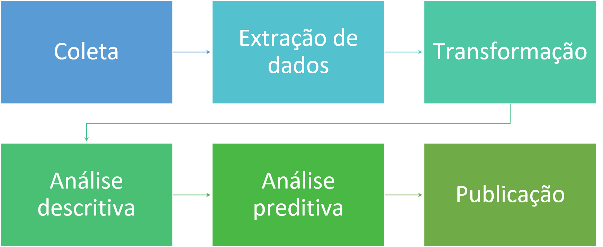

Nos capítulos anteriores, definimos uma pergunta econômica, identificamos os dados necessários e delimitamos o tipo de conclusão que a análise poderá produzir. Agora reuniremos essas decisões em um **plano de investigação em R**.

Planejar não significa antecipar cada comando ou impedir mudanças. O plano oferece uma direção inicial, torna as escolhas discutíveis e ajuda o grupo a identificar o que precisará aprender ao longo do curso.

O produto final não será apenas uma resposta ou um conjunto de resultados. Cada grupo deverá transformar o percurso da investigação em um **tutorial aplicado e reproduzível**, que possa ser compreendido, executado e adaptado por outras pessoas.

::: {.callout-note title="Objetivos do capítulo"}

Ao final deste capítulo, você deverá ser capaz de:

- organizar as etapas de uma investigação econômica em R;
- relacionar necessidades da análise a competências que ainda precisam ser aprendidas;
- propor uma estrutura inicial de pastas e arquivos;
- registrar decisões e mudanças ocorridas durante o trabalho;
- distribuir tarefas sem fragmentar a compreensão do projeto;
- elaborar o primeiro plano do tutorial reproduzível.

:::

## Reunindo as decisões anteriores

O planejamento começa pela recuperação dos três produtos já elaborados.

| Capítulo | Decisão construída | Pergunta de controle |
|---|---|---|
| 4 | Problema e pergunta | O que queremos investigar? |
| 5 | Fonte e informações necessárias | Com quais dados podemos investigar? |
| 6 | Alcance da conclusão | O que esses dados poderão sustentar? |

Essas decisões precisam ser coerentes entre si. Se a pergunta exige informações que a fonte não contém, ou se a conclusão pretendida ultrapassa a evidência possível, o plano deve retornar à etapa anterior e registrar a reformulação.

```{mermaid}
%%| fig-align: center
%%| fig-alt: "Fluxo da investigação na disciplina, do problema econômico ao tutorial reproduzível, com possibilidade de revisão"

flowchart LR
    A["Problema econômico"] --> B["Pergunta"]
    B --> C["Dados"]
    C --> D["Operações no R"]
    D --> E["Análise e interpretação"]
    E --> F["Validação"]
    F --> G["Tutorial reproduzível"]
    F -. "revisar" .-> B
    F -. "corrigir" .-> D

    classDef etapa fill:#E4F1E6,stroke:#2F5D3A,stroke-width:2px,color:#183A22;
    classDef produto fill:#FFF1D6,stroke:#8A6426,stroke-width:2px,color:#4A3512;
    class A,B,C,D,E,F etapa;
    class G produto;
    linkStyle default stroke:#2F5D3A,stroke-width:2px;
```

::: {.callout-important title="O planejamento também pode revelar que precisamos voltar"}

Descobrir uma incompatibilidade antes de escrever muitos códigos economiza trabalho. Reformular a pergunta, trocar a fonte ou reduzir o alcance da conclusão pode tornar o tutorial mais claro e executável.

:::

## Da necessidade econômica à operação no R

O grupo não precisa conhecer antecipadamente todos os comandos. O planejamento deve identificar **operações necessárias**, e não tentar adivinhar cada função que será utilizada.

| Necessidade da investigação | Operação necessária | Competência em R que poderá ser mobilizada |
|---|---|---|
| Obter uma base pública | importar ou baixar dados | leitura de arquivos, pacotes de acesso ou APIs |
| Identificar o grupo relevante | selecionar observações | filtros e condições lógicas |
| Reconstruir relações familiares | combinar registros do domicílio | agrupamentos e junções |
| Comparar períodos | organizar datas e calcular variações | transformação de datas e defasagens |
| Comparar ativos | alinhar séries e calcular retornos | transformação e combinação de séries |
| Comunicar um padrão | construir tabela ou gráfico | sumarização e visualização |

Essa tabela não é uma lista fechada. Ela será atualizada à medida que o grupo conhecer melhor a base e encontrar novos obstáculos.

::: {.callout-tip title="Formule primeiro a operação em linguagem comum"}

Antes de procurar um código pronto, escreva o que precisa acontecer:

> “Para cada domicílio, precisamos identificar se existe pelo menos uma criança com até cinco anos.”

Depois, decomponha a tarefa em operações menores e procure quais ferramentas do R permitem executá-las.

:::

## Etapas previstas da análise

Uma investigação aplicada geralmente percorre as etapas representadas na figura abaixo. O caminho real pode conter retornos, testes e reformulações.

{.lightbox fig-alt="Fluxo com coleta, extração de dados, transformação, análise descritiva, análise preditiva e publicação" fig-align="center" width="90%"}

Para os projetos da disciplina, detalharemos esse percurso da seguinte maneira.

### Obtenção

- localizar a fonte oficial;
- registrar o endereço e a data de acesso;
- compreender os formatos disponíveis;
- preservar os dados originais;
- documentar como a obtenção foi realizada.

### Importação e inspeção

- abrir os dados no R;
- observar dimensões, nomes e tipos das variáveis;
- confirmar a unidade de observação;
- consultar o dicionário e os metadados;
- identificar problemas iniciais.

### Organização e transformação

- selecionar as informações necessárias;
- tratar valores ausentes quando pertinente;
- ajustar tipos e formatos;
- combinar tabelas;
- construir variáveis economicamente relevantes;
- verificar resultados intermediários.

### Exploração e análise

- calcular medidas coerentes com a pergunta;
- construir tabelas e gráficos;
- comparar grupos, lugares ou períodos;
- investigar associações ou mecanismos quando apropriado;
- preservar os limites definidos no Capítulo 6.

### Interpretação e comunicação

- relacionar os resultados à pergunta;
- distinguir evidência de conjectura;
- registrar limitações;
- explicar as escolhas feitas;
- apresentar código e resultados em uma sequência compreensível.

### Validação

- executar novamente a análise desde o início;
- conferir números e transformações importantes;
- revisar a interpretação;
- solicitar leitura de outra pessoa;
- corrigir problemas antes da entrega.

::: {.callout-warning title="Nem toda investigação exige todas as etapas da mesma maneira"}

Um projeto com microdados domiciliares pode concentrar esforço na construção de variáveis. Uma aplicação macroeconômica pode exigir maior atenção a datas, frequências e revisões. Um tutorial financeiro pode precisar tratar preços ajustados e alinhamento dos dias de negociação.

O plano deve refletir as necessidades do problema, e não impor uma receita idêntica aos três campos.

:::

## Organização reproduzível do projeto

Uma análise reproduzível separa claramente arquivos originais, código e resultados. Uma estrutura inicial possível é:

```text
nome-do-projeto/
├── dados/
│   ├── originais/
│   └── tratados/
├── script/
├── figuras/
├── tabelas/
├── referencias/
├── tutorial.qmd
└── README.md
```

Essa estrutura poderá ser simplificada ou ampliada conforme o projeto. O princípio central é que outra pessoa consiga identificar:

- de onde vieram os dados;
- quais arquivos devem ser executados;
- em qual ordem;
- onde são produzidos os resultados;
- quais arquivos foram criados manualmente;
- quais decisões não estão representadas diretamente no código.

::: {.callout-important title="Dados originais devem permanecer originais"}

Evite editar manualmente o arquivo obtido da fonte. As correções e transformações devem ser registradas no código e produzir um novo arquivo tratado quando isso for necessário.

Assim, o processo pode ser repetido e auditado.

:::

## Caminhos relativos e execução do projeto

Os arquivos devem ser referenciados a partir da pasta do projeto, utilizando caminhos relativos.

Por exemplo:

```r
dados <- read.csv("dados/originais/base.csv")
```

Um caminho absoluto, como `C:/Users/nome/...`, funciona apenas no computador em que foi escrito. Um caminho relativo permite que o projeto seja transferido ou clonado mantendo a mesma estrutura.

O código apresentado aqui é apenas ilustrativo. As funções de importação serão explicadas nos capítulos técnicos antes de serem exigidas nas análises.

## Registro das decisões

Nem todas as escolhas ficam visíveis no resultado final. O grupo deverá manter um registro simples das decisões importantes.

| Data | Decisão ou mudança | Justificativa | Consequência para a análise |
|---|---|---|---|
|  |  |  |  |

Devem ser registradas, por exemplo:

- reformulações da pergunta;
- substituição da fonte de dados;
- mudanças no período ou no grupo estudado;
- definições adotadas para construir variáveis;
- exclusões de observações;
- limitações descobertas durante a análise;
- correções feitas após a validação.

Esse registro ajuda a escrever o tutorial e evita que decisões importantes dependam apenas da memória dos integrantes.

## Trabalho em grupo sem fragmentar o projeto

As tarefas podem ser distribuídas, mas todos os integrantes devem compreender o percurso geral da investigação.

Uma divisão possível inclui:

- acompanhamento da pergunta e da literatura;
- documentação da fonte e dos dados;
- importação e organização;
- construção de variáveis;
- tabelas e visualizações;
- redação e revisão;
- verificação da reprodução.

::: {.callout-warning title="Dividir tarefas não significa reunir partes isoladas no final"}

Se apenas uma pessoa compreende os dados e outra apenas escreve o texto, inconsistências podem permanecer invisíveis. O grupo deve revisar coletivamente pergunta, código, resultados e interpretação em cada entrega.

:::

## Inteligência artificial como apoio

Ferramentas de inteligência artificial poderão ajudar a:

- decompor uma tarefa em operações menores;
- explicar mensagens de erro;
- comparar alternativas de código;
- localizar conceitos na documentação;
- revisar legibilidade e comentários;
- sugerir testes para verificar uma transformação.

Entretanto, o grupo permanece responsável por todas as decisões e resultados.

::: {.callout-warning title="Código gerado também precisa ser compreendido e validado"}

A IA pode inventar funções, interpretar incorretamente uma variável ou sugerir uma operação inadequada ao problema. Não inclua no tutorial um código que o grupo não consegue explicar, executar e verificar.

Registre quando a IA contribuir de maneira relevante para uma decisão ou solução.

:::

## Do plano ao tutorial

O tutorial deverá registrar não apenas **o que funcionou**, mas o caminho necessário para que outra pessoa consiga adaptar a solução.

Uma estrutura inicial poderá conter:

1. problema econômico e motivação;
2. pergunta de investigação;
3. fonte e estrutura dos dados;
4. obtenção e importação;
5. preparação e construção das variáveis;
6. análise;
7. interpretação;
8. limitações;
9. possibilidades de adaptação;
10. referências.

Essa estrutura será refinada durante a disciplina. Nem todos os tutoriais precisarão atribuir o mesmo espaço a cada seção.

## Atividade — plano inicial da investigação

Reúna os produtos dos Capítulos 4, 5 e 6 e preencha o plano.

### Identificação

- **Área:** Microeconomia, Macroeconomia ou Finanças.
- **Título provisório do tutorial:**
- **Integrantes:**
- **Problema econômico:**
- **Pergunta inicial:**
- **Tipo de conclusão pretendida:**

### Dados

- **Fonte candidata:**
- **Unidade de observação:**
- **Período e recorte:**
- **Informações disponíveis:**
- **Informações que precisarão ser construídas:**
- **Limitações iniciais:**

### Operações e aprendizagem

Para cada necessidade, complete:

| O que precisamos fazer? | Por que é necessário? | O que já sabemos fazer? | O que precisamos aprender no R? |
|---|---|---|---|
|  |  |  |  |
|  |  |  |  |
|  |  |  |  |

### Organização e entregas

- **Estrutura inicial dos arquivos:**
- **Primeira divisão de responsabilidades:**
- **Resultados esperados para a próxima entrega:**
- **Principais riscos ou dúvidas:**
- **Forma de validação:**

::: {.callout-tip title="Checklist do plano"}

- [ ] A pergunta, os dados e a conclusão pretendida são compatíveis?
- [ ] As operações foram descritas antes da escolha dos comandos?
- [ ] O grupo identificou o que ainda precisa aprender?
- [ ] Dados, código e resultados terão locais distintos?
- [ ] Os caminhos poderão ser relativos?
- [ ] As decisões e mudanças serão registradas?
- [ ] Existe uma etapa explícita de validação?
- [ ] O plano conduz a um tutorial útil e reproduzível?

:::

::: {.callout-important title="Produto deste capítulo"}

A quarta entrega será o **plano inicial da investigação em R**. Ele reunirá as decisões construídas até aqui e estabelecerá as primeiras etapas de aprendizagem e desenvolvimento do tutorial.

O plano será revisado ao longo da disciplina. Sua função não é impedir mudanças, mas tornar o percurso controlável, discutível e reproduzível.

:::

Com o plano de investigação definido, passaremos da formulação do problema para a construção das competências necessárias à sua execução. Na Parte II, conheceremos o ambiente R e aprenderemos a organizar projetos, criar objetos, importar bases e verificar a qualidade dos dados.
