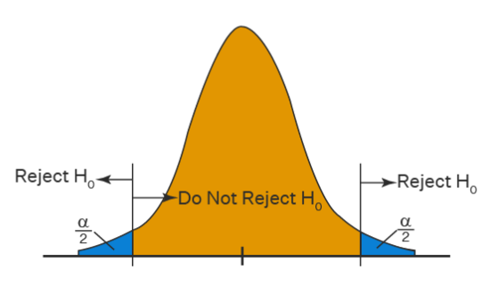

```{r}
#| include: false
knitr::opts_knit$set(root.dir = normalizePath(".."))
```

Nos capítulos anteriores, descrevemos distribuições e identificamos associações entre variáveis. Agora avançaremos uma etapa: utilizaremos **modelos lineares** para representar essas relações e comparar indivíduos com características observáveis diferentes.

Nossa pergunta orientadora será:

> Como escolaridade, experiência, tempo no emprego e sexo estão associados ao salário por hora?

O material parte da lógica desenvolvida por Wooldridge para dados de corte transversal. Nosso objetivo, porém, não é realizar um curso completo de econometria. A ênfase estará em **implementar, interpretar e comunicar uma análise econômica utilizando R**.

::: {.callout-note title="Objetivos do capítulo"}
Ao final deste capítulo, você deverá ser capaz de:

- formular uma regressão linear simples;
- estimar um modelo com `lm()`;
- interpretar intercepto, inclinação, valores ajustados e resíduos;
- compreender o papel do erro e do $R^2$;
- ampliar o modelo com outras variáveis explicativas;
- trabalhar com variáveis binárias, interações e termos quadráticos;
- interpretar modelos com o salário em logaritmo;
- reconhecer que uma regressão, isoladamente, não estabelece causalidade.
:::

## Preparando a base

Continuaremos utilizando a base reduzida derivada de `wage1`, do pacote `wooldridge`. Ela contém 526 pessoas e seis variáveis.

```{r}
library(tidyverse)

wage1_core <- readRDS("dados/wage1_core.rds")

wage1_modelos <- wage1_core |>
  mutate(
    sexo = if_else(female == 1, "Mulher", "Homem"),
    sexo = factor(sexo, levels = c("Homem", "Mulher"))
  )

glimpse(wage1_modelos)
```

As variáveis que utilizaremos são:

- `wage`: salário por hora, em dólares;
- `educ`: anos de escolaridade;
- `exper`: experiência potencial, em anos;
- `tenure`: tempo no emprego atual, em anos;
- `female`: variável binária, igual a 1 para mulheres e 0 para homens;
- `sexo`: versão categórica de `female`, criada para facilitar tabelas e gráficos.

::: {.callout-tip title="Por que continuar com a mesma base?"}
Já conhecemos a estrutura e as principais distribuições de `wage1_core`. Assim, podemos concentrar a atenção na nova ferramenta, sem interromper o raciocínio para aprender outra base.
:::

## Do gráfico ao modelo

No capítulo anterior, observamos uma associação positiva entre escolaridade e salário. Vamos retomar esse gráfico e acrescentar uma reta linear:

```{r}
ggplot(wage1_modelos, aes(x = educ, y = wage)) +
  geom_jitter(
    width = 0.15,
    height = 0,
    alpha = 0.4,
    color = "#3F6B5B"
  ) +
  geom_smooth(
    method = "lm",
    formula = y ~ x,
    se = FALSE,
    color = "#B45F4A",
    linewidth = 1
  ) +
  labs(
    title = "Salário por hora e escolaridade",
    subtitle = "A linha representa o ajuste de um modelo linear simples",
    x = "Escolaridade (anos)",
    y = "Salário por hora (US$)"
  ) +
  theme_minimal()
```

A nuvem de pontos mostra que pessoas com a mesma escolaridade podem receber salários diferentes. A reta não pretende passar por todos os pontos: ela resume como o **salário médio** varia com a escolaridade na amostra.

## Regressão linear simples

Começamos com o modelo populacional:

$$
wage_i = \beta_0 + \beta_1 educ_i + u_i
$$

O subscrito $i$ identifica cada pessoa. Nesse modelo:

- $wage_i$ é a variável dependente ou explicada;
- $educ_i$ é a variável explicativa;
- $\beta_0$ é o intercepto;
- $\beta_1$ representa a variação média no salário associada a um ano adicional de escolaridade;
- $u_i$ é o termo de erro.

O erro reúne fatores que afetam o salário, mas não estão explicitamente representados pelo modelo: habilidade, ocupação, setor, região, condições familiares, entre outros.

::: {.callout-warning title="Associação não é causalidade"}
O coeficiente de escolaridade informa uma associação média. Para interpretá-lo como efeito causal, precisaríamos justificar por que outros fatores presentes em $u_i$ não estão relacionados à escolaridade. Estimar uma regressão não resolve automaticamente esse problema.
:::

### A função de regressão populacional

Quando o modelo inclui um intercepto, podemos definir o erro de modo que sua média populacional seja zero:

$$
E(u)=0.
$$

Isso, porém, não garante que o erro tenha média zero para pessoas com diferentes níveis de escolaridade. Para interpretar a reta como a média condicional do salário, precisamos de uma condição mais forte. Se a média do erro, condicionada à escolaridade, for zero,

$$
E(u \mid educ) = 0,
$$

então:

$$
E(wage \mid educ) = \beta_0 + \beta_1 educ.
$$

Essa expressão é a **função de regressão populacional**. Ela relaciona cada nível de escolaridade ao salário médio esperado.

Em termos intuitivos, para cada nível de escolaridade, os fatores não observados que elevam o salário e os que reduzem o salário precisam se compensar, em média. Essa condição é exigente e não pode ser verificada apenas observando o resultado da regressão.

{fig-align="center" width="75%"}

::: {.callout-note collapse="true" title="Entenda mais: parte sistemática e termo de erro"}
Podemos reescrever o modelo como:

$$
wage_i = E(wage \mid educ_i) + u_i.
$$

Essa escrita separa o salário em duas partes:

- $E(wage \mid educ_i)$ é a parte sistemática representada pelo modelo;
- $u_i$ é a parte não explicada pela escolaridade.

A condição $E(u \mid educ)=0$ é mais forte do que simplesmente $E(u)=0$. Ela afirma que, em cada nível de escolaridade, os fatores não observados reunidos em $u$ possuem média zero. Se habilidade, origem familiar ou outro fator omitido estiver relacionado simultaneamente à escolaridade e ao salário, essa condição pode não ser válida.
:::

## Estimação por mínimos quadrados ordinários

Não conhecemos os parâmetros populacionais $\beta_0$ e $\beta_1$. Utilizamos a amostra para obter $\hat{\beta}_0$ e $\hat{\beta}_1$:

$$
\hat{\beta}_1 =
\frac{\sum_{i=1}^{n}(educ_i-\overline{educ})(wage_i-\overline{wage})}
{\sum_{i=1}^{n}(educ_i-\overline{educ})^2}
$$

e

$$
\hat{\beta}_0 = \overline{wage} - \hat{\beta}_1\overline{educ}.
$$

O método de **mínimos quadrados ordinários (MQO)** escolhe a reta que minimiza a soma dos quadrados dos resíduos.

{fig-align="center" width="70%"}

::: {.callout-note collapse="true" title="Entenda mais: a derivação dos estimadores de MQO"}
Para uma reta candidata, o resíduo da observação $i$ é:

$$
\hat{u}_i = wage_i-\hat{\beta}_0-\hat{\beta}_1 educ_i.
$$

O MQO escolhe $\hat{\beta}_0$ e $\hat{\beta}_1$ para minimizar a soma dos quadrados dos resíduos:

$$
\min_{\hat{\beta}_0,\hat{\beta}_1}
\sum_{i=1}^{n}
(wage_i-\hat{\beta}_0-\hat{\beta}_1 educ_i)^2.
$$

Derivando essa expressão em relação aos dois parâmetros e igualando as derivadas a zero, obtemos as condições de primeira ordem:

$$
\sum_{i=1}^{n}
(wage_i-\hat{\beta}_0-\hat{\beta}_1 educ_i)=0
$$

e

$$
\sum_{i=1}^{n}educ_i
(wage_i-\hat{\beta}_0-\hat{\beta}_1 educ_i)=0.
$$

Ao resolver esse sistema, chegamos a:

$$
\hat{\beta}_1 =
\frac{\sum_{i=1}^{n}(educ_i-\overline{educ})(wage_i-\overline{wage})}
{\sum_{i=1}^{n}(educ_i-\overline{educ})^2}
$$

e

$$
\hat{\beta}_0=\overline{wage}-\hat{\beta}_1\overline{educ}.
$$

Somar diretamente os resíduos faria desvios positivos e negativos se anularem. Ao elevar cada resíduo ao quadrado, todos contribuem positivamente para a medida de erro e desvios maiores recebem peso maior.
:::

::: {.callout-tip collapse="true" title="Entenda mais: calculando a inclinação sem `lm()`"}
Podemos reproduzir a fórmula do estimador diretamente no R:

```{r}
media_educ <- mean(wage1_modelos$educ)
media_wage <- mean(wage1_modelos$wage)

beta_1_manual <- sum(
  (wage1_modelos$educ - media_educ) *
    (wage1_modelos$wage - media_wage)
) / sum(
  (wage1_modelos$educ - media_educ)^2
)

beta_0_manual <- media_wage - beta_1_manual * media_educ

c(
  intercepto = beta_0_manual,
  escolaridade = beta_1_manual
)
```

Mais adiante, podemos comparar esses valores com os coeficientes produzidos por `lm()`.
:::

## Estimando o primeiro modelo com `lm()`

Em R, a função `lm()` estima modelos lineares. Sua fórmula coloca a variável dependente à esquerda de `~` e a explicativa à direita:

```{r}
modelo_simples <- lm(
  wage ~ educ,
  data = wage1_modelos
)

modelo_simples
```

Para obter informações mais completas:

```{r}
summary(modelo_simples)
```

### Como ler a saída de `summary()`

O resultado apresentado por `summary()` está organizado em blocos.

**1. Chamada do modelo — `Call`**

Repete a fórmula e a base utilizadas. Essa informação é útil para confirmar se estimamos o modelo pretendido.

**2. Resíduos — `Residuals`**

Apresenta cinco medidas da distribuição dos resíduos: mínimo, primeiro quartil, mediana, terceiro quartil e máximo. A mediana próxima de zero é esperada, mas esse resumo não substitui a análise gráfica dos resíduos.

**3. Coeficientes — `Coefficients`**

Cada linha corresponde a um parâmetro. As colunas informam:

- `Estimate`: valor estimado do coeficiente;
- `Std. Error`: erro-padrão da estimativa;
- `t value`: razão entre a estimativa e seu erro-padrão;
- `Pr(>|t|)`: valor-p do teste bilateral de que o coeficiente é zero.

Podemos solicitar somente essa tabela:

```{r}
coef(summary(modelo_simples))
```

Os símbolos ao lado dos valores-p são códigos de significância utilizados pelo R:

- `***`: valor-p menor que 0,001;
- `**`: valor-p menor que 0,01;
- `*`: valor-p menor que 0,05;
- `.`: valor-p menor que 0,10.

Esses símbolos são apenas uma convenção visual. A interpretação não deve se limitar a contar asteriscos.

**4. Erro-padrão residual**

Resume o tamanho típico dos resíduos na unidade da variável dependente. Neste modelo, está medido em dólares por hora. O resultado também informa os graus de liberdade usados em seu cálculo.

**5. $R^2$ e $R^2$ ajustado**

Mostram quanto da variação amostral de `wage` foi representada pelo modelo. A construção dessas medidas será examinada adiante.

**6. Estatística $F$**

Testa se o conjunto de coeficientes das variáveis explicativas é igual a zero. Na regressão simples, esse teste produz a mesma conclusão do teste $t$ para `educ`; em modelos com várias explicativas, ele testa os coeficientes conjuntamente.

A equação estimada pode ser escrita como:

$$
\widehat{wage}_i = \hat{\beta}_0 + \hat{\beta}_1 educ_i.
$$

Podemos extrair os coeficientes diretamente:

```{r}
coef(modelo_simples)
```

O coeficiente de `educ` indica quantos dólares por hora estão associados, em média, a um ano adicional de escolaridade. O intercepto representa o salário previsto para uma pessoa com zero ano de escolaridade. Embora seja necessário para posicionar a reta, essa situação está distante da maior parte da amostra e pode não ter interpretação econômica útil.

::: {.callout-important title="Leia coeficientes com unidade"}
Não basta dizer que o coeficiente é positivo ou negativo. Indique sempre:

1. qual variável está mudando;
2. qual é a magnitude da mudança;
3. em qual unidade a variável dependente é medida;
4. quais condições estão sendo mantidas fixas, quando houver outras variáveis no modelo.
:::

## Valores ajustados e resíduos

Para cada pessoa, o modelo produz um valor ajustado:

$$
\widehat{wage}_i = \hat{\beta}_0 + \hat{\beta}_1 educ_i.
$$

O resíduo é a diferença entre o salário observado e o salário ajustado:

$$
\hat{u}_i = wage_i - \widehat{wage}_i.
$$

Vamos acrescentar essas duas informações à base:

```{r}
wage1_ajustes <- wage1_modelos |>
  mutate(
    salario_ajustado = fitted(modelo_simples),
    residuo = residuals(modelo_simples)
  )

wage1_ajustes |>
  select(id, wage, educ, salario_ajustado, residuo) |>
  slice_head(n = 10)
```

- resíduo positivo: o salário observado está acima do ajustado;
- resíduo negativo: o salário observado está abaixo do ajustado;
- resíduo próximo de zero: a reta passa perto daquela observação.

```{r}
ggplot(wage1_ajustes, aes(x = residuo)) +
  geom_histogram(
    bins = 20,
    fill = "#7185CC",
    color = "white",
    alpha = 0.8
  ) +
  geom_vline(xintercept = 0, color = "#B45F4A", linewidth = 0.8) +
  labs(
    title = "Distribuição dos resíduos do modelo simples",
    x = "Resíduo (US$ por hora)",
    y = "Frequência"
  ) +
  theme_minimal()
```

::: {.callout-note collapse="true" title="Entenda mais: propriedades algébricas do MQO"}
Quando o modelo inclui intercepto, os resíduos de MQO possuem algumas propriedades na amostra:

- sua soma é zero;
- sua média é zero;
- sua covariância amostral com a variável explicativa é zero;
- a média dos valores ajustados é igual à média observada de $y$.

Podemos verificar essas propriedades no R:

```{r}
residuos_simples <- residuals(modelo_simples)
ajustados_simples <- fitted(modelo_simples)

tibble(
  propriedade = c(
    "Soma dos resíduos",
    "Média dos resíduos",
    "Covariância entre educação e resíduos",
    "Média dos valores ajustados",
    "Média dos salários observados",
    "Covariância entre ajustados e resíduos"
  ),
  valor = c(
    sum(residuos_simples),
    mean(residuos_simples),
    cov(wage1_modelos$educ, residuos_simples),
    mean(ajustados_simples),
    mean(wage1_modelos$wage),
    cov(ajustados_simples, residuos_simples)
  )
)
```

Valores muito pequenos, como $10^{-15}$, representam zero dentro da precisão numérica do computador.
:::

## Qualidade do ajuste

Depois de estimar uma regressão, precisamos avaliar quanto da variação observada no salário foi representada pela reta e quanto permaneceu nos resíduos. Para isso, começamos comparando três valores para cada pessoa:

- o salário observado, $wage_i$;
- a média salarial da amostra, $\overline{wage}$;
- o salário ajustado pelo modelo, $\widehat{wage}_i$.

```{r}
wage1_ajustes |>
  transmute(
    id,
    salario_observado = wage,
    salario_medio = mean(wage),
    salario_ajustado,
    residuo
  ) |>
  slice_head(n = 10)
```

Esses valores permitem decompor a variação do salário em duas partes.

```{mermaid}
%%| fig-align: center
%%| fig-alt: "Decomposição da variação total em variação explicada e residual"
%%| echo: false

flowchart LR
    A["Variação total<br/>SQT"] --> B["Variação representada<br/>pelo modelo — SQE"]
    A --> C["Variação que permanece<br/>nos resíduos — SQR"]

    classDef etapa fill:#DCEBDC,stroke:#355E3B,color:#1F3323,stroke-width:1.5px;
    class A,B,C etapa;
    linkStyle default stroke:#355E3B,stroke-width:1.5px;
```

::: {.callout-note collapse="true" title="Código Mermaid do fluxograma"}
```text
flowchart LR
    A["Variação total — SQT"] --> B["Variação representada pelo modelo — SQE"]
    A --> C["Variação que permanece nos resíduos — SQR"]

    classDef etapa fill:#DCEBDC,stroke:#355E3B,color:#1F3323,stroke-width:1.5px;
    class A,B,C etapa;
    linkStyle default stroke:#355E3B,stroke-width:1.5px;
```
:::

### Soma dos Quadrados Totais — SQT

A **Soma dos Quadrados Totais (SQT)** mede a variação total dos salários em torno da média:

$$
SQT=\sum_{i=1}^{n}(wage_i-\overline{wage})^2.
$$

Para cada pessoa, calculamos a distância entre o salário observado e a média. Elevamos essa distância ao quadrado e somamos os resultados. Quanto mais diferentes forem os salários, maior será a SQT.

```{r}
media_salario_modelo <- mean(wage1_modelos$wage)

sqt <- sum(
  (wage1_modelos$wage - media_salario_modelo)^2
)

sqt
```

A SQT não depende da regressão escolhida. Ela é uma característica da variável `wage` nesta amostra e será o total que desejamos decompor.

### Soma dos Quadrados Explicados — SQE

A **Soma dos Quadrados Explicados (SQE)** mede quanto os salários ajustados pelo modelo variam em torno da média observada:

$$
SQE=\sum_{i=1}^{n}(\widehat{wage}_i-\overline{wage})^2.
$$

Se a escolaridade não produzisse nenhuma diferença nos valores ajustados, todos eles ficariam próximos da média e a SQE seria pequena. Quanto mais a reta conseguir representar diferenças sistemáticas nos salários, maior será a SQE.

```{r}
sqe <- sum(
  (fitted(modelo_simples) - media_salario_modelo)^2
)

sqe
```

O nome “explicada” deve ser interpretado com cuidado: significa **representada estatisticamente pelo modelo**, e não necessariamente explicada em sentido causal.

### Soma dos Quadrados dos Resíduos — SQR

A **Soma dos Quadrados dos Resíduos (SQR)** mede a variação que permaneceu entre os salários observados e os valores ajustados:

$$
SQR=\sum_{i=1}^{n}(wage_i-\widehat{wage}_i)^2
=\sum_{i=1}^{n}\hat{u}_i^2.
$$

Quanto mais distantes os pontos estiverem da reta de regressão, maior será a SQR. Por isso, ela representa a parte da variação salarial que o modelo não conseguiu reproduzir.

```{r}
sqr <- sum(
  residuals(modelo_simples)^2
)

sqr
```

O MQO escolheu justamente os coeficientes que tornam essa SQR a menor possível entre todas as retas que poderiam ser traçadas para a amostra.

### Decompondo a variação total

Em uma regressão estimada por MQO com intercepto, vale a identidade:

$$
SQT=SQE+SQR.
$$

Isto é:

$$
\text{variação total}
=\text{variação representada pelo modelo}
+\text{variação que permaneceu nos resíduos}.
$$

Podemos verificar numericamente:

```{r}
tibble(
  medida = c("SQT", "SQE", "SQR", "SQE + SQR"),
  valor = c(sqt, sqe, sqr, sqe + sqr)
)
```

A pequena diferença que eventualmente apareça nas casas decimais decorre da precisão numérica utilizada pelo computador.

## O coeficiente de determinação: R²

O $R^2$ transforma essa decomposição em uma proporção. Ele mede qual parcela da variação total foi representada pelo modelo:

$$
R^2=\frac{SQE}{SQT}.
$$

Como $SQT=SQE+SQR$, temos também:

$$
R^2=1-\frac{SQR}{SQT}.
$$

Vamos calcular das duas maneiras:

```{r}
r2_pela_sqe <- sqe / sqt
r2_pela_sqr <- 1 - sqr / sqt
r2_do_modelo <- summary(modelo_simples)$r.squared

c(
  SQE_sobre_SQT = r2_pela_sqe,
  um_menos_SQR_sobre_SQT = r2_pela_sqr,
  informado_por_summary = r2_do_modelo
)
```

Os três resultados são iguais. Por exemplo, um $R^2$ de 0,20 significaria que 20% da variação amostral dos salários foi representada pela escolaridade no modelo e 80% permaneceu nos resíduos.

Valores próximos de 1 indicam que os valores ajustados acompanham grande parte da variação de `wage`; valores próximos de 0 indicam que grande parte dessa variação permanece nos resíduos.

::: {.callout-note collapse="true" title="Entenda mais: demonstrando a decomposição"}
Para cada observação, podemos escrever:

$$
wage_i-\overline{wage}
=(\widehat{wage}_i-\overline{wage})
+(wage_i-\widehat{wage}_i).
$$

O desvio total é a soma do desvio representado pela regressão e do resíduo. Ao elevar os dois lados ao quadrado e somar todas as observações, surge um termo cruzado. Nas regressões de MQO com intercepto, esse termo é zero porque valores ajustados e resíduos são ortogonais. Assim:

$$
\sum_{i=1}^{n}(wage_i-\overline{wage})^2
=\sum_{i=1}^{n}(\widehat{wage}_i-\overline{wage})^2
+\sum_{i=1}^{n}\hat{u}_i^2,
$$

o que corresponde a $SQT=SQE+SQR$.
:::

::: {.callout-warning title="$R^2$ não mede causalidade nem qualidade econômica"}
Um $R^2$ alto não torna uma relação causal. Um $R^2$ baixo também não invalida automaticamente um modelo. Em dados individuais, salários dependem de muitos fatores e é comum que uma especificação simples deixe grande variação sem explicar.
:::

## Incerteza e teste de hipótese

Os coeficientes foram calculados a partir de uma amostra. Outra amostra produziria valores um pouco diferentes. O erro-padrão procura resumir essa incerteza.

Para cada coeficiente, o `summary()` apresenta:

- `Estimate`: estimativa do coeficiente;
- `Std. Error`: erro-padrão da estimativa;
- `t value`: estatística do teste;
- `Pr(>|t|)`: valor-p.

Um teste frequente avalia:

$$
H_0: \beta_j = 0
\qquad \text{contra} \qquad
H_1: \beta_j \neq 0.
$$

Um valor-p pequeno indica que uma estimativa tão distante de zero seria pouco compatível com $H_0$, sob as hipóteses do modelo.

{fig-align="center" width="65%"}

Em um teste bilateral, resultados muito negativos ou muito positivos podem fornecer evidência contra a hipótese nula. A decisão depende do nível de significância definido e não apenas da posição visual da estimativa.

::: {.callout-note collapse="true" title="Entenda mais: estatística t e intervalo de confiança"}
Para testar $H_0:\beta_j=0$, calculamos:

$$
t=\frac{\hat{\beta}_j-0}{EP(\hat{\beta}_j)},
$$

em que $EP(\hat{\beta}_j)$ é o erro-padrão do estimador. Quanto maior a estimativa em relação ao seu erro-padrão, mais distante de zero estará a estatística $t$.

Também podemos construir um intervalo de confiança de 95%:

$$
\hat{\beta}_j \pm t_{crítico}\times EP(\hat{\beta}_j).
$$

O R calcula esses intervalos com `confint()`:

```{r}
confint(modelo_simples)
```

Se o intervalo de 95% não contém zero, o teste bilateral rejeita $H_0:\beta_j=0$ ao nível de 5%, sob as hipóteses utilizadas para a inferência.
:::

::: {.callout-important title="O que um valor-p não informa"}
O valor-p não mede a importância econômica do coeficiente, não fornece a probabilidade de a hipótese nula ser verdadeira e não resolve problemas de especificação ou causalidade. Magnitude, unidade, incerteza e contexto econômico devem ser interpretados conjuntamente.
:::

## Regressão linear múltipla

O salário não depende apenas da escolaridade. Podemos incluir outras características observadas:

$$
wage_i = \beta_0 + \beta_1 educ_i + \beta_2 exper_i +
\beta_3 tenure_i + u_i.
$$

```{r}
modelo_multiplo <- lm(
  wage ~ educ + exper + tenure,
  data = wage1_modelos
)

summary(modelo_multiplo)
```

Agora, $\hat{\beta}_1$ mede a associação entre um ano adicional de escolaridade e o salário por hora **mantendo fixas experiência e permanência no emprego**. Essa interpretação, conhecida como *ceteris paribus*, é a principal contribuição da regressão múltipla.

Da mesma forma:

- o coeficiente de `exper` compara pessoas com escolaridade e permanência no emprego semelhantes;
- o coeficiente de `tenure` compara pessoas com escolaridade e experiência semelhantes.

Adicionar variáveis não torna automaticamente o modelo causal. A interpretação depende de quais fatores foram controlados, de quais permaneceram no erro e de como eles se relacionam com as variáveis incluídas.

::: {.callout-note collapse="true" title="Entenda mais: média condicional zero na regressão múltipla"}
No modelo múltiplo, a condição relevante pode ser escrita como:

$$
E(u\mid educ,exper,tenure)=0.
$$

Ela afirma que, depois de fixar simultaneamente escolaridade, experiência e tempo no emprego, o erro possui média zero. Se um fator omitido estiver relacionado ao salário e também a alguma dessas explicativas, os coeficientes podem incorporar parte dessa relação omitida.

Controlar por mais variáveis pode ajudar, mas não garante que a condição seja satisfeita. A seleção dos controles deve ser orientada pela pergunta econômica e pelo desenho da investigação.
:::

::: {.callout-note collapse="true" title="Entenda mais: MQO em notação matricial"}
Com várias variáveis explicativas, podemos organizar o modelo como:

$$
\mathbf{y}=\mathbf{X}\boldsymbol{\beta}+\mathbf{u},
$$

em que $\mathbf{y}$ reúne os valores da variável dependente, $\mathbf{X}$ contém uma coluna de 1 para o intercepto e as variáveis explicativas, e $\boldsymbol{\beta}$ reúne os parâmetros.

O MQO minimiza:

$$
(\mathbf{y}-\mathbf{X}\boldsymbol{\beta})'
(\mathbf{y}-\mathbf{X}\boldsymbol{\beta}).
$$

As condições de primeira ordem produzem as equações normais:

$$
\mathbf{X}'\mathbf{X}\hat{\boldsymbol{\beta}}
=\mathbf{X}'\mathbf{y}.
$$

Quando $\mathbf{X}'\mathbf{X}$ é invertível:

$$
\hat{\boldsymbol{\beta}}
=(\mathbf{X}'\mathbf{X})^{-1}\mathbf{X}'\mathbf{y}.
$$

Essa expressão ajuda a compreender o cálculo, mas o aluno não precisa fazer manualmente a álgebra matricial para utilizar `lm()` e interpretar seus resultados.
:::

```{mermaid}
%%| fig-align: center
%%| fig-alt: "Interpretação condicional em um modelo linear múltiplo"
%%| echo: false

flowchart LR
    A["Escolaridade"] --> D["Salário por hora"]
    B["Experiência"] --> D
    C["Tempo no emprego"] --> D
    E["Outros fatores<br/>no erro"] -.-> D

    classDef etapa fill:#DCEBDC,stroke:#355E3B,color:#1F3323,stroke-width:1.5px;
    class A,B,C,D,E etapa;
    linkStyle default stroke:#355E3B,stroke-width:1.5px;
```

::: {.callout-note collapse="true" title="Código Mermaid do fluxograma"}
```text
flowchart LR
    A["Escolaridade"] --> D["Salário por hora"]
    B["Experiência"] --> D
    C["Tempo no emprego"] --> D
    E["Outros fatores no erro"] -.-> D

    classDef etapa fill:#DCEBDC,stroke:#355E3B,color:#1F3323,stroke-width:1.5px;
    class A,B,C,D,E etapa;
    linkStyle default stroke:#355E3B,stroke-width:1.5px;
```
:::

### Comparando modelos

```{r}
comparacao_modelos <- tibble(
  modelo = c("Simples", "Múltiplo"),
  r_quadrado = c(
    summary(modelo_simples)$r.squared,
    summary(modelo_multiplo)$r.squared
  ),
  r_quadrado_ajustado = c(
    summary(modelo_simples)$adj.r.squared,
    summary(modelo_multiplo)$adj.r.squared
  )
)

comparacao_modelos
```

O $R^2$ nunca diminui quando acrescentamos variáveis. O $R^2$ ajustado introduz uma penalidade pela inclusão de regressores e pode diminuir quando uma variável contribui pouco para o ajuste.

::: {.callout-note collapse="true" title="Entenda mais: $R^2$ ajustado e teste F"}
O $R^2$ ajustado considera o tamanho da amostra, $n$, e o número de variáveis explicativas, $k$:

$$
\bar{R}^2
=1-\frac{(1-R^2)(n-1)}{n-k-1}.
$$

Ao contrário do $R^2$, ele pode diminuir quando acrescentamos uma variável que contribui pouco para o modelo.

A estatística $F$ permite testar conjuntamente:

$$
H_0:\beta_1=\beta_2=\cdots=\beta_k=0.
$$

A alternativa afirma que pelo menos um desses coeficientes é diferente de zero. Podemos recuperar a estatística e seu valor-p da saída do modelo:

```{r}
f_modelo <- summary(modelo_multiplo)$fstatistic

estatistica_f <- unname(f_modelo["value"])
gl_numerador <- unname(f_modelo["numdf"])
gl_denominador <- unname(f_modelo["dendf"])

valor_p_f <- pf(
  estatistica_f,
  gl_numerador,
  gl_denominador,
  lower.tail = FALSE
)

c(
  estatistica_F = estatistica_f,
  graus_de_liberdade_numerador = gl_numerador,
  graus_de_liberdade_denominador = gl_denominador,
  valor_p = valor_p_f
)
```

Rejeitar $H_0$ indica evidência de que as variáveis possuem relevância conjunta na especificação. Isso não demonstra causalidade nem garante que o modelo esteja corretamente especificado.
:::

## Variável binária: diferenças entre grupos

Uma variável binária assume os valores 0 e 1. Em `wage1_core`, `female` é igual a 1 para mulheres e 0 para homens. Vamos incorporá-la ao modelo:

$$
wage_i = \beta_0 + \delta_1 female_i + \beta_1 educ_i +
\beta_2 exper_i + \beta_3 tenure_i + u_i.
$$

```{r}
modelo_sexo <- lm(
  wage ~ female + educ + exper + tenure,
  data = wage1_modelos
)

summary(modelo_sexo)
```

Como homens formam o grupo `female = 0`, o coeficiente de `female` representa a diferença salarial média das mulheres em relação aos homens, mantendo constantes escolaridade, experiência e permanência no emprego.

Podemos escrever as duas retas implícitas no modelo. Para homens, `female = 0`:

$$
\widehat{wage}
=\hat{\beta}_0+\hat{\beta}_1educ
+\hat{\beta}_2exper+\hat{\beta}_3tenure.
$$

Para mulheres, `female = 1`:

$$
\widehat{wage}
=(\hat{\beta}_0+\hat{\delta}_1)
+\hat{\beta}_1educ+\hat{\beta}_2exper+\hat{\beta}_3tenure.
$$

Assim, $\hat{\delta}_1$ desloca o intercepto, enquanto as inclinações permanecem iguais para os dois grupos nesta especificação.

::: {.callout-warning title="Diferença condicional ainda não é discriminação causal"}
O modelo controla apenas as variáveis disponíveis. Ocupação, setor, jornada, região e outras características não estão em `wage1_core`. O coeficiente descreve uma diferença condicional nesta especificação; isoladamente, ele não identifica toda a origem da desigualdade salarial.
:::

### Variáveis com mais de duas categorias

Uma variável qualitativa pode possuir várias categorias. Para ilustrar, agruparemos a escolaridade em três faixas:

```{r}
wage1_categorias <- wage1_modelos |>
  mutate(
    faixa_educacao = case_when(
      educ < 12 ~ "Menos de 12 anos",
      educ == 12 ~ "12 anos",
      educ > 12 ~ "Mais de 12 anos",
      .default = NA_character_
    ),
    faixa_educacao = factor(
      faixa_educacao,
      levels = c(
        "12 anos",
        "Menos de 12 anos",
        "Mais de 12 anos"
      )
    )
  )

table(wage1_categorias$faixa_educacao)
```

Definimos “12 anos” como categoria de referência. O R criará indicadores para as outras duas categorias e comparará cada uma delas com o grupo de referência:

```{r}
modelo_categorias <- lm(
  wage ~ faixa_educacao + female + exper + tenure,
  data = wage1_categorias
)

coef(summary(modelo_categorias))
```

O intercepto se refere ao grupo de referência quando as demais variáveis numéricas são zero. Cada coeficiente de `faixa_educacao` representa uma diferença em relação às pessoas com 12 anos de escolaridade, mantendo constantes sexo, experiência e tempo no emprego.

::: {.callout-note collapse="true" title="Entenda mais: por que uma categoria precisa ser referência?"}
Se incluíssemos um intercepto e uma variável binária para cada uma das três categorias, a soma das três binárias seria sempre igual a 1, exatamente como a coluna do intercepto. Uma coluna poderia ser obtida a partir das outras, criando colinearidade perfeita.

Por isso, com $g$ categorias e um intercepto, utilizamos $g-1$ indicadores. A categoria omitida não desaparece da análise: ela se torna o grupo de comparação incorporado ao intercepto.
:::

## Interações: a associação pode variar entre grupos

Até aqui, o modelo supõe que a associação entre experiência e salário é igual para homens e mulheres. Uma interação permite que essa inclinação seja diferente:

```{r}
modelo_interacao <- lm(
  wage ~ educ + tenure + female * exper,
  data = wage1_modelos
)

summary(modelo_interacao)
```

O operador `*` inclui três termos: `female`, `exper` e `female:exper`.

- para homens (`female = 0`), a inclinação da experiência é o coeficiente de `exper`;
- para mulheres (`female = 1`), a inclinação é a soma dos coeficientes de `exper` e `female:exper`.

Podemos calcular as duas inclinações:

```{r}
coef_interacao <- coef(modelo_interacao)

tibble(
  sexo = c("Homem", "Mulher"),
  inclinacao_experiencia = c(
    coef_interacao["exper"],
    coef_interacao["exper"] + coef_interacao["female:exper"]
  )
)
```

Para visualizar o modelo, produzimos previsões para perfis que mantêm escolaridade e tempo no emprego em seus valores médios:

```{r}
perfis_experiencia <- expand_grid(
  exper = seq(
    min(wage1_modelos$exper),
    max(wage1_modelos$exper),
    by = 1
  ),
  female = c(0, 1)
) |>
  mutate(
    educ = mean(wage1_modelos$educ),
    tenure = mean(wage1_modelos$tenure),
    sexo = if_else(female == 1, "Mulher", "Homem"),
    salario_previsto = predict(modelo_interacao, newdata = pick(everything()))
  )

ggplot(
  perfis_experiencia,
  aes(x = exper, y = salario_previsto, color = sexo)
) +
  geom_line(linewidth = 1) +
  scale_color_manual(values = c("Homem" = "#3F566F", "Mulher" = "#B45F4A")) +
  labs(
    title = "Salário previsto por experiência e sexo",
    subtitle = "Escolaridade e tempo no emprego mantidos em suas médias",
    x = "Experiência potencial (anos)",
    y = "Salário previsto por hora (US$)",
    color = "Sexo"
  ) +
  theme_minimal()
```

## Relações não lineares nas variáveis

Um modelo linear nos parâmetros pode conter um termo quadrático. Isso é útil quando um ano adicional de experiência não possui a mesma associação com o salário em toda a trajetória profissional:

$$
wage_i = \beta_0 + \beta_1 exper_i + \beta_2 exper_i^2 + u_i.
$$

```{r}
modelo_quadratico <- lm(
  wage ~ exper + I(exper^2),
  data = wage1_modelos
)

summary(modelo_quadratico)
```

O efeito marginal de mais um ano de experiência depende do nível de experiência:

$$
\frac{\Delta wage}{\Delta exper}
= \hat{\beta}_1 + 2\hat{\beta}_2 exper.
$$

Portanto, os dois coeficientes devem ser interpretados conjuntamente.

Podemos calcular a associação marginal da experiência em diferentes pontos da trajetória:

```{r}
coef_quadratico <- coef(modelo_quadratico)

tibble(
  experiencia = c(0, 5, 10, 20, 30),
  variacao_associada =
    coef_quadratico["exper"] +
    2 * coef_quadratico["I(exper^2)"] * experiencia
)
```

Se o coeficiente do termo quadrático for negativo, a associação permanece positiva inicialmente, mas diminui à medida que a experiência aumenta. Isso não significa que todas as pessoas terão exatamente essa trajetória; trata-se do formato médio estimado pelo modelo.

## Unidade de medida

A interpretação de um coeficiente depende da unidade de cada variável. Em `wage1_core`, `wage` está em dólares por hora e `educ` em anos.

Suponha que expressemos o salário em centavos. Como multiplicamos a variável dependente por 100, os coeficientes também serão multiplicados por 100:

```{r}
wage1_unidades <- wage1_modelos |>
  mutate(
    wage_centavos = wage * 100,
    educ_meses = educ * 12
  )

modelo_dolares <- lm(wage ~ educ, data = wage1_unidades)
modelo_centavos <- lm(wage_centavos ~ educ, data = wage1_unidades)

rbind(
  dolares = coef(modelo_dolares),
  centavos = coef(modelo_centavos)
)
```

Agora expressamos a escolaridade em meses. Como a variável explicativa foi multiplicada por 12, seu coeficiente será dividido por 12:

```{r}
modelo_anos <- lm(wage ~ educ, data = wage1_unidades)
modelo_meses <- lm(wage ~ educ_meses, data = wage1_unidades)

rbind(
  escolaridade_em_anos = coef(modelo_anos),
  escolaridade_em_meses = coef(modelo_meses)
)
```

A relação substantiva não mudou; apenas alteramos sua unidade de apresentação.

::: {.callout-note collapse="true" title="Entenda mais: o que permanece igual quando mudamos a unidade?"}
Uma transformação linear de unidade altera a escala dos coeficientes, mas não altera o conteúdo estatístico da relação:

- se $y$ é multiplicado por uma constante $c$, intercepto e inclinações são multiplicados por $c$;
- se $x$ é multiplicado por $c$, o coeficiente de $x$ é dividido por $c$;
- estatísticas $t$, valores-p e $R^2$ permanecem iguais.

Podemos confirmar o último ponto:

```{r}
tibble(
  modelo = c("dólares e anos", "centavos e anos", "dólares e meses"),
  r_quadrado = c(
    summary(modelo_dolares)$r.squared,
    summary(modelo_centavos)$r.squared,
    summary(modelo_meses)$r.squared
  )
)
```
:::

## Formas funcionais e logaritmos

Uma relação pode ser linear nos níveis ou utilizar logaritmos. A escolha deve acompanhar a pergunta econômica e a forma observada nos dados.

| Modelo | Variável dependente | Explicativa | Interpretação de $\beta_1$ |
|---|---|---|---|
| Nível–nível | $y$ | $x$ | uma unidade em $x$ está associada a $\beta_1$ unidades em $y$ |
| Nível–log | $y$ | $\log(x)$ | 1% em $x$ está associado a aproximadamente $\beta_1/100$ unidade em $y$ |
| Log–nível | $\log(y)$ | $x$ | uma unidade em $x$ está associada a aproximadamente $100\beta_1$% em $y$ |
| Log–log | $\log(y)$ | $\log(x)$ | 1% em $x$ está associado a $\beta_1$% em $y$ |

Antes de aplicar um logaritmo, precisamos verificar se a variável possui apenas valores positivos:

```{r}
wage1_modelos |>
  summarise(
    menor_salario = min(wage),
    menor_escolaridade = min(educ),
    escolaridade_zero = sum(educ == 0)
  )
```

O salário é positivo em toda a amostra, mas existem pessoas com `educ = 0`. Como $\log(0)$ não é definido, os modelos que utilizam `log(educ)` serão estimados apenas para observações com escolaridade positiva:

```{r}
wage1_log_educ <- wage1_modelos |>
  filter(educ > 0)
```

::: {.callout-warning title="Uma transformação pode mudar a amostra"}
Excluir observações não deve ser uma operação automática. Precisamos registrar quantas observações foram afetadas e reconhecer que modelos estimados com amostras diferentes não são diretamente comparáveis. Aqui fazemos a restrição para demonstrar a forma funcional.
:::

### Modelo nível–nível

Este é o modelo utilizado desde o início do capítulo:

$$
wage_i=\beta_0+\beta_1 educ_i+u_i.
$$

```{r}
modelo_nivel_nivel <- lm(
  wage ~ educ,
  data = wage1_modelos
)

coef(summary(modelo_nivel_nivel))
```

O coeficiente de `educ` mede a variação em dólares por hora associada a um ano adicional de escolaridade.

### Modelo nível–log

Agora mantemos o salário em nível e utilizamos o logaritmo da escolaridade:

$$
wage_i=\beta_0+\beta_1\log(educ_i)+u_i.
$$

```{r}
modelo_nivel_log <- lm(
  wage ~ log(educ),
  data = wage1_log_educ
)

coef(summary(modelo_nivel_log))
```

Um aumento de 1% na escolaridade está associado a aproximadamente $\hat{\beta}_1/100$ dólar por hora. Como escolaridade é medida em anos inteiros, essa forma funcional é mais útil para compreender a interpretação do que como especificação principal desta aplicação.

### Modelo log–nível

Salários possuem distribuição assimétrica e são frequentemente analisados em logaritmo:

$$
\log(wage_i)=\beta_0+\beta_1 educ_i+u_i.
$$

```{r}
modelo_log_nivel <- lm(
  log(wage) ~ educ,
  data = wage1_modelos
)

coef(summary(modelo_log_nivel))
```

Um ano adicional de escolaridade está associado a uma variação aproximada de $100\hat{\beta}_1$% no salário por hora.

### Modelo log–log

Quando as duas variáveis aparecem em logaritmo:

$$
\log(wage_i)=\beta_0+\beta_1\log(educ_i)+u_i.
$$

```{r}
modelo_log_log <- lm(
  log(wage) ~ log(educ),
  data = wage1_log_educ
)

coef(summary(modelo_log_log))
```

O coeficiente $\hat{\beta}_1$ é uma **elasticidade**: um aumento de 1% na escolaridade está associado a uma variação de $\hat{\beta}_1$% no salário.

::: {.callout-note collapse="true" title="Entenda mais: aproximações percentuais nos modelos com log"}
Para pequenas variações, utilizamos:

$$
\Delta\log(y)\approx\frac{\Delta y}{y}.
$$

Por isso, em um modelo log–nível, $100\beta_1$ fornece uma aproximação percentual. Para uma variação de $\Delta x$ unidades, a transformação exata é:

$$
100\left[\exp(\beta_1\Delta x)-1\right].
$$

Quanto menor for $\beta_1\Delta x$, mais próximas serão a aproximação e a transformação exata.
:::

### Modelo log–nível com controles

Voltamos à aplicação econômica com sexo, escolaridade, experiência e permanência no emprego:

```{r}
modelo_log <- lm(
  log(wage) ~ female + educ + exper + tenure,
  data = wage1_modelos
)

summary(modelo_log)
```

Para `educ`, a aproximação usual interpreta $100\hat{\beta}$ como a variação percentual no salário associada a um ano adicional de escolaridade, mantendo as demais variáveis constantes.

Para a variável binária `female`, utilizamos a transformação:

$$
100\left[\exp(\hat{\delta})-1\right].
$$

```{r}
beta_female <- coef(modelo_log)["female"]

100 * (exp(beta_female) - 1)
```

## Uma primeira leitura dos resíduos

Estimar um modelo e interpretar seus coeficientes não encerra a análise. Precisamos observar se os resíduos revelam algum padrão que o modelo não representou.

Não faremos aqui um diagnóstico econométrico completo. Utilizaremos apenas um gráfico para responder a uma pergunta inicial:

> A dispersão dos erros parece semelhante ao longo dos valores ajustados pelo modelo?

Em uma situação ideal, esperamos encontrar pontos distribuídos ao redor de zero, sem uma curva evidente e sem uma abertura crescente ou decrescente. Vamos comparar duas especificações já estimadas:

- `modelo_sexo`: salário em dólares por hora;
- `modelo_log`: logaritmo do salário por hora.

Como as variáveis dependentes possuem escalas diferentes, utilizaremos resíduos padronizados:

```{r}
diagnostico_nivel <- tibble(
  ajustado = fitted(modelo_sexo),
  residuo_padronizado = rstandard(modelo_sexo),
  especificacao = "Salário em nível"
)

diagnostico_log <- tibble(
  ajustado = fitted(modelo_log),
  residuo_padronizado = rstandard(modelo_log),
  especificacao = "Logaritmo do salário"
)

diagnostico_modelos <- bind_rows(
  diagnostico_nivel,
  diagnostico_log
)

ggplot(
  diagnostico_modelos,
  aes(x = ajustado, y = residuo_padronizado)
) +
  geom_point(alpha = 0.4, color = "#3F6B5B") +
  geom_hline(
    yintercept = 0,
    color = "#B45F4A",
    linewidth = 0.8
  ) +
  facet_wrap(
    vars(especificacao),
    scales = "free_x"
  ) +
  labs(
    title = "Resíduos e valores ajustados",
    subtitle = "Comparação entre o salário em nível e em logaritmo",
    x = "Valor ajustado pelo modelo",
    y = "Resíduo padronizado"
  ) +
  theme_minimal()
```

No modelo com salário em nível, a dispersão aumenta à medida que os valores ajustados crescem. Os erros são maiores entre os salários mais elevados, formando uma abertura semelhante a um leque.

No modelo com o logaritmo do salário, a dispersão fica mais equilibrada. A transformação não elimina todos os problemas nem prova que o segundo modelo seja correto, mas mostra por que logaritmos são frequentes em aplicações com salários e rendimentos.

::: {.callout-important title="O diagnóstico não é uma regra automática de escolha"}
Não devemos selecionar um modelo apenas porque um gráfico parece mais regular. A forma funcional também precisa ser coerente com a pergunta econômica e com a interpretação desejada.
:::

::: {.callout-note collapse="true" title="Entenda mais: existem outros diagnósticos?"}
Sim. Uma análise econométrica pode examinar, entre outros aspectos:

- linearidade da relação;
- variância constante dos erros;
- observações com grande influência;
- resíduos muito distantes;
- colinearidade entre explicativas;
- especificação e variáveis omitidas;
- distribuição dos resíduos, quando ela for necessária para determinada inferência.

O padrão de dispersão crescente observado no primeiro gráfico é associado à **heterocedasticidade**. Ela não torna automaticamente os coeficientes de MQO inutilizáveis, mas pode afetar os erros-padrão e, consequentemente, testes e intervalos de confiança. Em uma disciplina de econometria, poderíamos avançar para testes formais e erros-padrão robustos.

Nesta introdução ao R, o objetivo é mais simples: aprender a não tratar a saída de `lm()` como o fim automático da análise.
:::

## O que a sequência de modelos nos ensinou?

```{mermaid}
%%| fig-align: center
%%| fig-alt: "Evolução da análise com modelos lineares"
%%| echo: false

flowchart LR
    A["Associação<br/>bivariada"] --> B["Regressão<br/>simples"]
    B --> C["Regressão<br/>múltipla"]
    C --> D["Grupos e<br/>interações"]
    D --> E["Forma funcional<br/>e diagnóstico"]
    E --> F["Interpretação<br/>econômica"]

    classDef etapa fill:#DCEBDC,stroke:#355E3B,color:#1F3323,stroke-width:1.5px;
    class A,B,C,D,E,F etapa;
    linkStyle default stroke:#355E3B,stroke-width:1.5px;
```

::: {.callout-note collapse="true" title="Código Mermaid do fluxograma"}
```text
flowchart LR
    A["Associação bivariada"] --> B["Regressão simples"]
    B --> C["Regressão múltipla"]
    C --> D["Grupos e interações"]
    D --> E["Forma funcional e diagnóstico"]
    E --> F["Interpretação econômica"]

    classDef etapa fill:#DCEBDC,stroke:#355E3B,color:#1F3323,stroke-width:1.5px;
    class A,B,C,D,E,F etapa;
    linkStyle default stroke:#355E3B,stroke-width:1.5px;
```
:::

Modelos lineares permitem passar da descrição de uma associação para comparações condicionais mais informativas. Ainda assim, sua interpretação depende da pergunta econômica, das variáveis disponíveis, da forma funcional e das hipóteses adotadas.

## Pratique

Utilizando `wage1_modelos`:

1. estime uma regressão simples de `wage` sobre `exper`;
2. interprete o intercepto e o coeficiente de `exper` em suas unidades;
3. acrescente `educ` e `tenure` e compare o coeficiente de experiência;
4. compare o $R^2$ e o $R^2$ ajustado dos dois modelos;
5. estime um modelo com `log(wage)` como variável dependente;
6. escreva uma conclusão que diferencie associação condicional de efeito causal.

::: {.callout-tip collapse="true" title="Código inicial"}
```{r}
modelo_experiencia <- lm(
  wage ~ exper,
  data = wage1_modelos
)

modelo_experiencia_controles <- lm(
  wage ~ exper + educ + tenure,
  data = wage1_modelos
)

summary(modelo_experiencia)
summary(modelo_experiencia_controles)
```
:::
