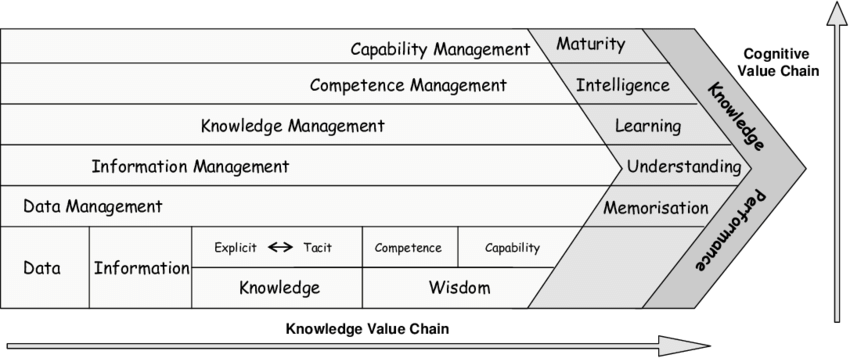
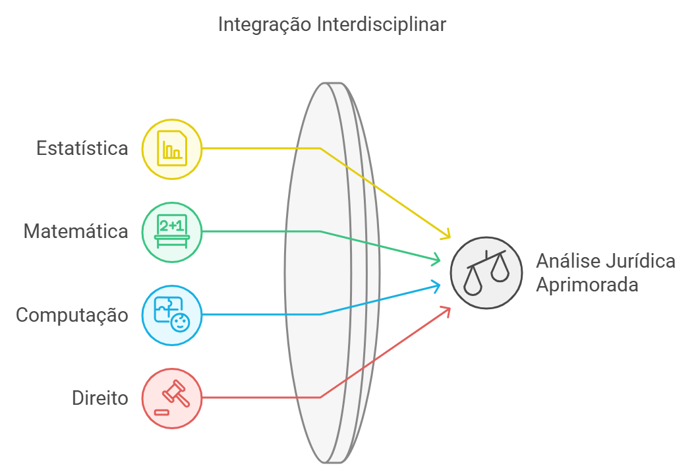
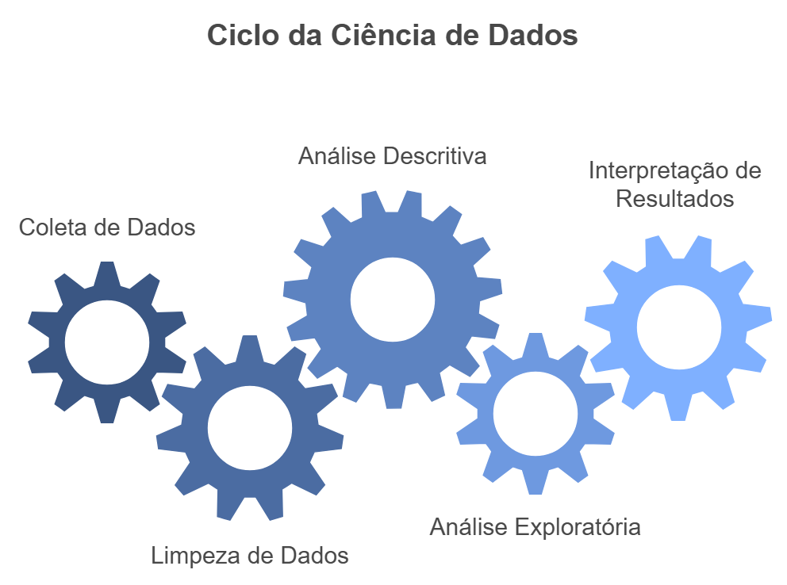

## Cadeia de Valor do Conhecimento

A construção do conhecimento é um caminho longo e complexo. A cadeia de valor do conhecimento é um modelo que busca representar esse caminho. Vejamos a Figura abaixo:

{width="80%"}

Para cumprir esse longo percurso a Ciência de Dados tem um papel fundamental na atualidade.

A Ciência de Dados é uma área interdisciplinar que combina conhecimentos de estatística, matemática, computação, e no nosso caso do Direito, para extrair conhecimento a partir de dados.

{width="70%"}

A Ciência de Dados é um processo que envolve diversas etapas, como a coleta de dados, a organização dos dados, a análise dos dados, a interpretação dos resultados, entre outras. Vejamos a figura sobre ciclo de vida da ciência de dados:

{width="70%"}

O ciclo de vida da ciência de dados é um modelo que descreve as etapas envolvidas no processo de análise de dados. Esse modelo é composto por cinco etapas principais:

1.  **Coleta de Dados**: Busca de informações que possam ser úteis para responder a uma pergunta de pesquisa. Esses dados podem ser coletados de diversas fontes, como pesquisas de campo, bases de dados, entrevistas, entre outros.

2.  **Limpar e Organização**: Pesquisador organiza os dados coletados de forma a facilitar a análise. Isso pode envolver a criação de tabelas, limpeza, estruturação, entre outros aspectos.

3.  **Análise Descritiva**: Busca descrever os dados coletados de forma a identificar padrões, tendências, relações entre variáveis, entre outros aspectos. Isso pode envolver a utilização de estatísticas descritivas, gráficos, mapas, entre outros recursos.

4.  **Análise Exploratória**: Explorar os dados coletados de forma a identificar padrões, tendências, relações entre variáveis, entre outros aspectos. Isso pode envolver a utilização de técnicas estatísticas mais avançadas, como regressão, análise de cluster, análise fatorial, entre outras.

5.  **Interpretação dos Resultados**: Interpretar os resultados obtidos na análise descritiva e exploratória de forma a responder à pergunta de pesquisa. Isso pode envolver a elaboração de conclusões, recomendações, entre outros aspectos.

## Estatísticas Descritivas: Medidas Numéricas a partir da amostra

A análise descritiva é uma etapa fundamental no processo de análise de dados. Ela consiste em descrever os dados coletados de forma a identificar padrões, tendências, relações entre variáveis, entre outros aspectos.

Vamos entender 3 padrões importantes nessa etapa:

1.  **Medidas de Posição**: São medidas que indicam a posição de um valor em relação aos demais valores de um conjunto de dados.

2.  **Medidas de Variabilidade**: São medidas que indicam o grau de dispersão dos valores de um conjunto de dados.

3.  **Medidas de Associação**: São medidas que indicam a relação entre duas ou mais variáveis de um conjunto de dados.

Vamos entender os resultados dessas medidas para dois conjuntos distintos de variáveis:

1.  **Variáveis Discretas**: São variáveis que podem assumir um número finito de valores. Por exemplo, o número de filhos de uma pessoa, o número de processos em uma Vara, procedente ou improcedente.

2.  **Variáveis Contínuas**: São variáveis que podem assumir um número infinito de valores. Por exemplo, a renda per capita, a taxa de feminicídio, tempo do processo, dosimetria da pena.

**CASO DE ESTUDO:**

Vamos tentar entender essas medidas a partir de um banco de dados real e pequeno. Será utilizado um banco de dados extraído do [Anuário da Segurança Pública (2023)](https://publicacoes.forumseguranca.org.br/items/6b3e3a1b-3bd2-40f7-b280-7419c8eb3b39){.external target="_blank"}, com informações sobre a taxa de feminicídio, a taxa de tentativa de feminicídio, a taxa de homicídio de mulheres, a renda per capita, entre outras variáveis.

As medidas numéricas que veremos para as três padrões a serem observados são:

**MEDIDAS DE POSIÇÃO:**

-   Média,
-   Mediana,
-   Moda,
-   Percentis,
-   Quartis.

**MEDIDAS DE VARIABILIDADE:**

-   Amplitude,
-   Amplitude interquartil,
-   Variância,
-   Desvio Padrão e
-   Coeficiente de Variação.

**MEDIDAS DE ASSOCIAÇÃO:**

-   Covariancia e
-   Coeficiente de Correlção.

Vamos apresentar as fórmulas de algumas dessas principais medidas.Primeiramente vams importantaro nosso banco de dados:

```{r}
final_fem_22 <- read.csv("../dados/final_fem_22.csv", head=T ,sep=";")

```

ou

```{r eval=FALSE}

install.packages("remotes") # baixar o pacote devtools
remotes::install_github("jjesusfilho/cursoESMP") # baixar o pacote deste curso
library(cursoESMP) # carregar o pacote deste curso
final_fem_22<-cursoESMP::final_fem_22

```

Visualizando as primeiras 10 linhas do banco de dados:

```{r warning=FALSE, message=FALSE}
library(kableExtra)

final_fem_22 |> 
  head(10) |> 
  kbl(digits = 2,  ) %>%
     kable_styling()
```

::: {.callout-note appearance="simple" collapse="true" title="Descrição do Banco de Dados"}
1.  **homic_abs**: Número absoluto de homicídios feminínos registrados em 2022.

2.  **homic_tx**: Taxa de homicídios feminino 100 mil mulheres.

3.  **feminic_abs**: Número absoluto de feminicídios registrados em 2022.

4.  **feminic_tx**: Taxa de feminicídios por 100 mil mulheres.

5.  **part_feminic**: Participação percentual dos feminicídios no total de homicídios femininos.

6.  **rendapc**: Renda per capita do Estado.

7.  **mais_50**: Proporção de feminicídios acima de 50%.

8.  **t_homic_abs**: Número absoluto da tentativa de homicídios femininos

9.  **t_homic_tx**: Taxa de tentativa de homicídios para 100 mil mulheres.

10. **t_feminic_abs**: Número absoluto de tentativa de feminicídios.

11. **t_feminic_tx**: Taxa de tentativa de feminicídios por 100 mil mulheres.

12. **part_t_feminic**: Participação percentual da tentativa de feminicídios em relação ao total de tentativas de homicídios femininos.
:::

### Gráficos no R

O ggplot2 é um pacote do R utilizado para criar gráficos estatísticos de forma poderosa e flexível. Apesar de parecer complexo, é fácil de aprender, pois possui princípios básicos simples e poucos casos excepcionais.O ggplot2 é projetado para ser utilizado iterativamente: você começa com os dados brutos e adiciona camadas de anotações ou resumos estatísticos.

**A GRAMÁTICA DOS GRÁFICOS**

O ggplot2 é um pacote do R que implementa a Grammar of Graphics (Wilkinson, 2005), uma abordagem para criar gráficos estatísticos. Ele organiza os gráficos em componentes fundamentais, permitindo flexibilidade e personalização.

Um gráfico no ggplot2 é construído combinando os seguintes elementos:

1.  **Dados**: A base de dados a ser visualizada.
2.  **Mapeamentos estéticos**(aes): Define como variáveis são associadas a atributos visuais (cor, forma, tamanho).
3.  **Camadas** (layers): Compostas por:
    -   **Geoms**: Elementos visuais - tipos de gráficos (pontos, linhas, barras).
    -   **Stats**: Transformações estatísticas ou ajustar modelos.
    -   **Escalas** (scales): Determina as esclaas de x e y (eixos, legendas, cores).
4.  **Sistemas de coordenadas** (coord): Define como os dados são posicionados no gráfico (ex.: cartesiano ou polar).
5.  **Facetamento** (facet): Divide os dados em subconjuntos para gerar gráficos separados.
6.  **Tema** (theme): Personaliza detalhes visuais, como fontes e cores de fundo.

Clique abaixo para ver alguns tipos de gráficos que podem ser criados com o ggplot2:

::: {.callout-note appearance="simple" collapse="true" title="Veja aqui Algumas Possibilidades de Camadas"}
-   `geom_area()`: cria um gráfico de área.\
-   `geom_density()`: cria um gráfico de densidade de kernel.\
-   `geom_dotplot()`: cria um gráfico de pontos.\
-   `geom_freqpoly()`: cria um polígono de frequência.\
-   `geom_histogram()`: cria um histograma.\
-   `stat_ecdf()`: plota a função de densidade acumulada empírica.\
-   `stat_qq()`: cria um gráfico quantil-quantil.\
-   `geom_bar()`: cria um gráfico de barras.
:::

Vejamos um exemplo inicial de um gráfico da taxa de homicídio feminino e a taxa de feminicídio por Estado no Brasil

Primeiro, definindo os dados que serão utilizados e os eixos x e y, vejamos o que ocorre:

```{r}
library(ggplot2)
ggplot(data = final_fem_22, aes(x = homic_tx, y = feminic_tx))
```

Agora podemos adicionar uma camada de pontos ao gráfico:

```{r}
ggplot(data = final_fem_22, aes(x = homic_tx, y = feminic_tx))+
  geom_point()
```

Podemos fazer com que cada ponto seja associado a uma região do Brasil:

```{r}
ggplot(data = final_fem_22, aes(x = homic_tx, y = feminic_tx, colour=regiao))+
  geom_point()
```

Ou podemos fazer que todos os pontos seja azul escuro:

```{r}
ggplot(data = final_fem_22, aes(x = homic_tx, y = feminic_tx))+
  geom_point(color="darkblue")
```

Para as cores uma possibilidade bem flexível é usar cores [Hexadecimais](https://htmlcolorcodes.com/). Vamos usar a cor `#6e94bd` para os pontos:

Podemos mudar o tamanho `size`, a transparência com `alpha` e a forma `shape` dos pontos:

```{r}
ggplot(data = final_fem_22, aes(x = homic_tx, y = feminic_tx))+
  geom_point(color="#6e94bd", size=3, alpha=0.7,  shape=17) +
  scale_x_continuous(limits = c(0, 13))
```

::: {.callout-note appearance="simple" collapse="true" title="Clique aqui para ver os `shapes` disponíveis"}
-   **shape = 0**: quadrado\
-   **shape = 1**: círculo\
-   **shape = 2**: triângulo apontando para cima\
-   **shape = 3**: sinal de mais (+)\
-   **shape = 4**: cruz (x)\
-   **shape = 5**: losango\
-   **shape = 6**: triângulo apontando para baixo\
-   **shape = 7**: quadrado com cruz\
-   **shape = 8**: estrela\
-   **shape = 9**: losango com sinal de mais\
-   **shape = 10**: círculo com sinal de mais\
-   **shape = 11**: triângulos apontando para cima e para baixo\
-   **shape = 12**: quadrado com sinal de mais\
-   **shape = 13**: círculo com cruz\
-   **shape = 14**: quadrado com triângulo apontando para baixo\
-   **shape = 15**: quadrado preenchido\
-   **shape = 16**: círculo preenchido\
-   **shape = 17**: triângulo preenchido apontando para cima\
-   **shape = 18**: losango preenchido\
-   **shape = 19**: círculo sólido\
-   **shape = 20**: ponto (círculo menor)\
-   **shape = 21**: círculo preenchido azul\
-   **shape = 22**: quadrado preenchido azul\
-   **shape = 23**: losango preenchido azul\
-   **shape = 24**: triângulo preenchido apontando para cima azul\
-   **shape = 25**: triângulo preenchido apontando para baixo azul
:::

Agora vamos adicionar uma escala para o eixo de x entre 0 e 13 e vamos dividir o gráfico por região:

```{r}
ggplot(data = final_fem_22, aes(x = homic_tx, y = feminic_tx))+
  geom_point(color="#6e94bd", size=3, alpha=0.7,  shape=17) +
  scale_x_continuous(limits = c(0, 13))+
  facet_wrap(~regiao)
```

Pode-se também adicionar uma linha de tendência ao gráfico:

```{r warning=FALSE, message=FALSE}
ggplot(data = final_fem_22, aes(x = homic_tx, y = feminic_tx))+
  geom_point(color="#6e94bd", size=3, alpha=0.7,  shape=17) +
  scale_x_continuous(limits = c(0, 13))+
  geom_smooth(method = "lm", se=FALSE , color="orange")+
  facet_wrap(~regiao)
```

E por fim pode-se mudar o título e os rótulos dos eixos:

```{r warning=FALSE, message=FALSE}

library(ggthemes)
ggplot(data = final_fem_22, aes(x = homic_tx, y = feminic_tx))+
geom_point(color="#6e94bd", size=3, alpha=0.7,  shape=17) +
scale_x_continuous(limits = c(0, 13))+
geom_smooth(method = "lm", se=FALSE , color="orange")+
facet_wrap(~regiao)+  
labs(title="Homicídios e Feminicídios por Região", x="Homicídios", y="Feminicídios")+
theme_bw()
```

Para os temas pode acessar a [Galeria](https://r-graph-gallery.com/package/ggthemes.html) ou [Exemplos Dinâmicos](https://r-graph-gallery.com/ggplot2-package.html#theme-widget).

## Medidas de Posição:

**MÉDIA AMOSTRAL:**

$$\bar{x} = \frac{1}{n} \sum_{i=1}^{n} x_i$$

```{r, warning=F}
mean(final_fem_22$feminic_tx)
```

A média da taxa de Feminicídio entre os Estados do Brasil é de 1,65 por 100 mil mulheres em 2022 .

```{r, warning=F}
library(kableExtra)

mean_1<- aggregate(final_fem_22[4:15], list(final_fem_22$regiao), mean,  na.rm=T)

t(mean_1) %>% 
  kbl(digits = 2) %>%
     kable_styling()
```

**MEDIANA:**

Organize os dados em ordem crescente.

a)  Para um numero impar de observações a mediana é o valor que ocupa a posição central.

b)  para um número par de observações, a mediana é a média dos dois valores centrais.

```{r, warning=F}
median(final_fem_22$feminic_tx)
```

Veja que a mediana é um valor diferente da média. Elas medem coisas diferentes. Veja o exemplo abaixo

```{r, warning=F}
median(c(1,3, 14))
mean(c(1,3, 14))
```

Mediana e média são bastante distintas. Vamos fazer uma tabela com a Média e Mediana, para o nosso conjunto de dados.

```{r, warning=F}

fun1 <- function(x, na.rm = TRUE) c(Média=mean(x, na.rm = TRUE), Mediana=median(x, na.rm = TRUE))

median_1 <- (sapply(final_fem_22[4:15], fun1))

t(median_1) %>% 
  kbl(digits = 2) %>%
     kable_styling()

```

**MODA:**

Moda é o valor que ocorre com mais frequência.

```{r, warning=F}
moda <- function(x, na.rm=T) {
modal <- unique(x, na.rm=T)
modal[which.max(tabulate(match(x, modal)))]
}
moda(final_fem_22$feminic_tx)
```

```{r, warning=F}

fun1 <- function(x, na.rm = TRUE) c(Média=mean(x, na.rm = TRUE), Mediana=median(x, na.rm = TRUE), Moda=moda(x))

median_1 <- (sapply(final_fem_22[4:15], fun1))

t(median_1) %>% 
  kbl(digits = 2) %>%
     kable_styling()

```

#### Visualizando as medidas por categorias

**Gráfico de Pizza**

O gráfico de pizza indica as proporções de uma determinada variável de classe. Aqui utilizamos a média do número de feminicídios absoluto por região.

```{r}
ggplot(mean_1, aes(x = "", y = feminic_abs, fill = Group.1)) +
  geom_col(width = 1, color = "lightgray") +
  coord_polar(theta = "y") +
  labs(title = "Média Feminicídio por Região", fill = "Região") +
  theme_minimal() +
  theme(axis.title = element_blank(),
        axis.text = element_blank(),
        axis.ticks = element_blank())+ 
  scale_fill_brewer(palette="PuBu")
```

```{r eval=FALSE ,echo=FALSE}
# Maneira Tradicional
pie(mean_1$feminic_abs , main = "Média Feminicídio por Região", 
    labels = c("CO","N","NE","S","SD"), border="lightgray")
```

::: {.callout-tip title="Exercício"}
**PERGUNTA**: Qual a proporção de estados que possuem taxas de feminicídio acima de 50%?
:::

::: {.callout-warning title="Veja a Resposta" appearance="simple" collapse="true"}
**RESPOSTA**: Participação é uma variável disecreta do tipo 0 ou 1 (binárias) que indica se a taxa de feminicídio é maior que 50%.

```{r message=FALSE, warning=FALSE}
library(dplyr)
final_fem_22 |> 
  group_by(mais_50) |>
  summarise(cont = n()) |> 
  mutate(mais_50F = factor(mais_50, levels = c(0, 1), labels = c("Abaixo de 50%", "Acima de 50%"))) |> 
  ggplot( aes(x="", y =cont, fill=mais_50F)) +
  geom_bar(stat="identity", width = 1, color = "lightgray") +
  coord_polar(theta = "y", start=0)+
  labs(title = "Participação do Feminicídio no Total de Homicídios Femininos", fill = "Participação Feminicídio") +
  theme_minimal() +
  theme(axis.title = element_blank(),
        axis.text = element_blank(),
        axis.ticks = element_blank())+
  scale_fill_brewer(palette="Blues")
```
:::

**Gráfico de Barra**

Em geral a utilização do gráfico de barras está relacionado ao entendimento da frequência de valores associados a uma determinada categoria. Por exemplo, imagine que temos um banco de dados com as pessoas classificadas como: i)Não trabalha; ii)Trabalha e iii)Desempregado. Teríamos três categorias e a frequência de pessoas em cada categoria. Poderíamos ainda dividir essa categoria entre homens e mulheres. Essa é a utilização mais padrão do gráfico de barras. Vejamos alguns gráficos:

```{r}
ggplot(final_fem_22, aes(x = reorder(estados, -feminic_tx), y = feminic_tx)) +
  geom_bar(stat = "identity", fill = "salmon2", alpha=0.5, color = "lightsalmon4") +
  labs(title = "Taxa de Feminicídio por Estado",
       x = "",
       y = "Tx. por 100 mil") +
  theme_minimal() +
  theme(axis.text.x = element_text(angle = 90, vjust = 0.5, hjust = 1, size = 9)) 
```

Vamos fazer um gráfico de barras para a participação do Feminicídio no total de homicídios femininos por Estado.

```{r}
ggplot(final_fem_22, aes(x = reorder(estados, -part_feminic), y = part_feminic)) + # Ordem decrescente
  geom_col( fill = "#3f566f", alpha=0.7, color = "#4c5471") +                      # Adiciona as barras, cor das barras, transparencia 
  labs(                                                                            # e cor da borda
    title = "Participação da Taxa de Feminicídio no Total por Estado",             # Título do gráfico
    x = "",                                                                        # Rótulo do eixo x
    y = "Tx. por 100 mil"                                                          # Rótulo do eixo y
  ) +
  theme_bw() +
  theme(axis.text.x = element_text(angle = 90, hjust = 1, size = 9))              # Ajusta o tamanho do texto do eixo x
```

**Gráfico de Barras Agrupadas**

Vamos fazer um gráfico de barras agrupadas para a taxa de feminicídio e taxa de tentativa de feminicídio por região. Vamos passo a passo:

1.  Transformar os dados em formato long

```{r message=FALSE, warning=FALSE}
library(tidyr)
library(dplyr)

# Transformar os dados no formato long
tx_long <- final_fem_22 %>%
  arrange(desc(feminic_tx)) %>%                          # Ordena pelos valores de feinic_tx, decrescente
  select(estados, regiao, feminic_tx, t_feminic_tx) %>%  # Seleciona as colunas de interesse
  pivot_longer(cols = c(feminic_tx, t_feminic_tx),       # Converte para formato longo
               names_to = "tipo",                        # Nome da coluna que identificará as variáveis
               values_to = "taxa")                       # Nome da coluna que armazenará os valores

head(tx_long)
```

2.  Criar o gráfico de barras lado a lado

```{r message=FALSE, warning=FALSE}
# Criar o gráfico de barras lado a lado
ggplot(tx_long, aes(x = reorder(estados, -taxa), y = taxa, fill = tipo)) +
  geom_bar(stat = "identity",alpha=0.7,  position = "dodge", color = "white") +               # Barras lado a lado posição dodge faz isso
  labs(
    title = "Comparação das Taxas de Feminicídio por Estado",                     # Título do gráfico
    x = "", # Rótulo do eixo x                                                    # Rótulo do eixo x, y e legenda
    y = "Tx. por 100 mil",                                                        
    fill = "Tipo de Taxa"                                                                
  ) +
  scale_fill_manual(
        values = c("feminic_tx" = "#7185cc", "t_feminic_tx" = "#c2986f"),              # Definir as cores para cada variável
        labels = c("feminic_tx" = "Feminicídio", "t_feminic_tx" = "Tentativa de Fem.") # Definir os rótulos para cada variável
                    ) +  
  theme(axis.text.x = element_text(angle = 90, hjust = 1, size = 8))                    # Ajusta o tamanho do texto do eixo x
```

**Gráfico de Linha**

O gráfico de linha ou pontos é muito utilizado para visualização da evolução de séries. É um gráfico que nos permite ver a evolução dos salários entre homens e mulheres, evolução dos preços dos alimentos, evolução do número de casos de feminicídio, evolução dos processos em determinada Vara.

Nosso banco é uma fotografia e não uma evolução, o que torna esse tipo de visualização menos útil. Vejamos a como a taxa de feminicídio evolui com o aumento do número total Homicídios Femininos.

```{r message=FALSE, warning=FALSE}
# Ordenar os dados pelo número absoluto de homicídios do menor para o maior
final_fem_22 <- final_fem_22[order(-final_fem_22$homic_abs),]

# Criar o gráfico com ggplot2
ggplot(final_fem_22, aes(x = homic_abs)) +
# Linha para 't_feminic_tx'
  geom_line(aes(y = t_feminic_tx, color = "Tentativa"), linewidth = 0.8, alpha=0.4) +
  geom_point(aes(y = t_feminic_tx, color = "Tentativa"), size = 3, shape = 17) +
# Linha para 'feminic_tx'
  geom_line(aes(y = feminic_tx, color = "Feminicídio"), linewidth = 0.8, alpha=0.4) +
  geom_point(aes(y = feminic_tx, color = "Feminicídio"), size = 3, shape = 19) +
# Escala de cores para as linhas
  scale_color_manual(
    values = c("Tentativa" = "#c2986f", "Feminicídio" = "#7185cc")
  ) +
# Títulos e rótulos
  labs(
    title = "Tentativa e Feminicídio: Taxa",
    x = "Total de Homicídios",
    y = "Taxa / 100 mil",
    color = "Tipo"
  ) +
 # Ajustes de tema
  theme_minimal() +
  theme(
    plot.title = element_text(hjust = 0.5, size = 14, face = "bold"),  # Centraliza o título, tamanho e negrito
    legend.position = "top",                                           # Posiciona a legenda no topo
    legend.title = element_text(size = 10),                            # Ajusta o tamanho do título da legenda
    legend.text = element_text(size = 9)                               # Ajusta o tamanho do texto da legenda
  )

```

::: {.callout-tip title="Exercício"}
**PERGUNTA**: Será que quanto maior for a renda per capita, menor será a taxa de feminicídio?
:::

::: {.callout-warning title="Veja a Resposta" appearance="simple" collapse="true"}
**RESPOSTA**: Renda e taxa de feminicídio são variáveis continuas. O ideal seria utilizar um gráfico de dispersão para verificar a relação entre essas variáveis.

```{r message=FALSE, warning=FALSE}
ggplot(data = final_fem_22, aes(x = rendapc, y = feminic_tx))+
geom_point(color="#6e94bd", size=3, alpha=0.7,  shape=17) +
geom_smooth(method = "lm", se=TRUE , color="orange")+
labs(title="Renda pc e taxa de Feminicídios por Estado", x="Renda pc", y="Tx 100 mil")+
theme_bw()
```
:::

**PERCENTIL:**

O p-esimo percentil é um valor tal que ao menos p por cento das observações são menores ou iguais à ele e pelo menos (100-p) por cento das observações são maiores ou iguais a esse valor.

*Etapas para calcular o p-ésimo percentil*

**Etapa 1**: Organize os dados em ordem crescente.

**Etapa 2**: Calcule um indice, $i$ tal que $$i = \frac{p}{100} \times n$$ onde $p$ é o percentil procurado

**Etapa 3**:

a)  Se $i$ não for um número inteiro, arredondeo-o para cima. O próximo número inteiro maior que $i$ denota a posição do p-esimo percentil.
b)  Se $i$ for um número inteiro o p-esimo percentil será a média dos valores que o ocupam as posições $i$ e $i + 1$.

```{r, warning=F}

quantile(final_fem_22$feminic_tx, probs = c(0.10,0.30,0.60,0.85), na.rm=T)

```

**QUARTIS:**

Os quartis são medidas estatísticas que dividem um conjunto de dados ordenados em quatro partes iguais. É um caso particular do percentil.

O três quartis são:

**Primeiro Quartil (Q1)**: Representa o valor abaixo do qual está situada a primeira quarta parte (ou 25% inferiores) dos dados quando eles estão ordenados em ordem crescente. O primeiro quartil é o valor que divide os dados em 25% (ou 0.25) abaixo e 75% (ou 0.75) acima desse ponto.

**Segundo Quartil (Q2)**: Corresponde à mediana dos dados, dividindo o conjunto em duas metades iguais. É o valor que separa os 50% inferiores dos 50% superiores dos dados.

**Terceiro Quartil (Q3)**: Indica o valor acima do qual está situada a terceira quarta parte (ou 25% superiores) dos dados quando eles estão ordenados. Assim como o primeiro quartil, o terceiro quartil divide os dados em 75% (ou 0.75) abaixo e 25% (ou 0.25) acima desse ponto

```{r, warning=F}

quantile(final_fem_22$feminic_tx, na.rm=T)

```

## Medidas de Variabilidade

**AMPLITUDE:**

Amplitude é a diferença entre o valor mínimo e máximo de uma série de dados.

$$\text{Amplitude} = \text{Maior Valor} - \text{Menor Valor}$$

```{r}
min_max<-range(final_fem_22$feminic_tx)
amp<-min_max[2]-min_max[1]
amp
```

**AMPLITUDE INTERQUANTIL:**

A amplitude interquartil é dada pela diferenca entre o terceiro ($Q_3$) e o primeiro quartil ($Q_1$).

$$IQR = Q_3 - Q_1$$

```{r}
qs<-quantile(final_fem_22$feminic_tx, na.rm=T)
iq<-qs[4]-qs[2]
IQR(final_fem_22$feminic_tx)
iq
```

**VARIÂNCIA E DESVIO PADRÃO AMOSTRAL**:

A variância amostral é uma medida estatística que indica o quão dispersos estão os dados em relação à média amostral. Em outras palavras, ela quantifica a extensão das diferenças individuais entre os valores observados e a média da amostra.

Definimos a variância amostral como:

$$s^2 = \frac{\sum_{i=1}^{n} (x_i - \bar{x})^2}{n-1}$$ onde $\bar{x}$ é a média amostral.

Vejamos a variância da taxa de feminicídio e do femnicídio absoluto:

```{r}
var(final_fem_22$feminic_tx, na.rm=T)

var(final_fem_22$feminic_abs, na.rm=T)

```

O **Desvio padrão amostral** é derivado da variância. Podemos qualcular essa estatística da seguinte maneira:

$$s = \sqrt{s^2} = \sqrt{\frac{\sum_{i=1}^{n} (x_i - \bar{x})^2}{n-1}}$$

Para os nossos dados anteriores:

```{r}

# Tx Feminicídio
sd(final_fem_22$feminic_tx, na.rm=T)

#Feminicídio Absoluto
sd(final_fem_22$feminic_abs, na.rm=T)


```

Vamos consolidar agora nossas estatísticas descritivas em uma tabela:

```{r, warning=F}

fun1 <- function(x, na.rm = TRUE) c(Média=mean(x, na.rm = TRUE), Mediana=median(x, na.rm = TRUE), Var=var(x, na.rm = TRUE), DP=sd(x, na.rm = TRUE))

est_descrit <- (sapply(final_fem_22[4:15], fun1))

t(est_descrit) %>% 
  kbl(digits = 1) %>%
     kable_styling()

```

**COEFICIENTE DE VARIAÇÃO**:

O coeficiente de variação (CV) é uma medida de dispersão relativa que expressa a variabilidade dos dados como uma porcentagem da média.

$$\text{CV} = \left( \frac{\text{Desvio padrão}}{\text{Média}} \right) \times 100\%$$

```{r}
# O R nao tem nehuma funçao para isso, mas podemos fazer isso rapidamente
print((sd(final_fem_22$feminic_abs, na.rm = TRUE)/ mean(final_fem_22$feminic_abs, na.rm = TRUE)) * 100)
print((sd(final_fem_22$t_feminic_abs, na.rm = TRUE)/ mean(final_fem_22$t_feminic_abs, na.rm = TRUE)) * 100)

```

Para entendermos vamos supor que existam duas variáveis com mesmo desvio padrão, igual a 10. A primeira terá média de 10 e a segunda de 20, vejamos a diferença no coeficiente de variação.

$\text{CV}_{X_1}=\frac{10}{10}.100=100\%$ e $\text{CV}_{X_2}=\frac{10}{20}.100=50\%$

A variabilidade relativa é menor para a segunda variável. No exemplo acima a taxa de feminicídio tem uma variabilidade relativa maior (91%) do que a tentativa de feminicídio (74%) entre os Estados Brasileiros.

#### Visualizando a Distribuição dos Dados

**Boxplot**

O boxplot é um gráfico que traz muitas informações e pode ser visto como a distribuição de probabilidade dos dados. O box ou caixa contém 50% dos dados. O limite superior indica o percentil de 75% (*Q3*) e o limite inferior indica o percentil de 25% (*Q1*). A linha que corta o box indica a mediana, ou seja, *Q2*. Os bigodes são calculados com base na distância interquantílica, ou seja,

*Limite inferior: Q1-1,5(Q3-Q1)*

*Limite superior:Q3+1,5(Q3-Q1)*

Dados fora desses limites são classificados como suspeitos de serem outliers. Podemos observar a assimetria dos dados quando a mediana não está no meio da caixa, indicando maior densidade na menor distância entre os quartis Q1 ou Q3 e a mediana Q2. Vejamos agora o boxplot da taxa de feminicídio e da taxa de feminicídio por região.

```{r}
ggplot(final_fem_22, aes(y = feminic_tx)) +
  geom_boxplot(fill = "steelblue", color = "darkblue", alpha=0.7,  # Linhas tracejadas no boxplot
    outlier.shape = 16, outlier.color = "red", outlier.size = 3) + # Boxplot com preenchimento azul e bordas pretas
  labs(
    title = "Boxplot da Taxa de Feminicídio no Brasil, 2022", # Título do gráfico
    x = "",                                                   # Sem rótulo no eixo x
    y = "Tx de Feminicídio / 100 mil"                        # Rótulo do eixo y
  ) +
  coord_flip() + # Inverte os eixos para horizontalidade
  scale_x_continuous(limits = c(-0.8, 0.8)) +                      # Limita o eixo y entre 0 e 6
  theme_bw() + # Tema limpo e moderno
  theme(
    plot.title = element_text(hjust = 0.5, size = 14, face = "bold"), # Centraliza e estiliza o título
    axis.text.y = element_text(size = 10), # Ajusta o tamanho do texto no eixo y
    axis.title.y = element_text(size = 12) # Ajusta o tamanho do rótulo do eixo y
  )
```

```{r}
ggplot(final_fem_22, aes(x = regiao, y = feminic_tx, fill = regiao)) +
  geom_boxplot( 
    color = "darkblue", alpha=0.7,                                     # Boxplot linha azul, outlier vermelho e transparete 
    outlier.shape = 16, outlier.color = "red", outlier.size = 3
              ) + 
  labs(
    title = "Boxplot da Taxa de Feminicídio no Brasil, 2022",         # Título do gráfico, x e y e nome da legenda
    x = "Região",                                                   
    y = "Tx de Feminicídio / 100 mil",
    fill = "Região"  # Rótulo do eixo y
      ) +
  coord_flip() +                                                      # Inverte os eixos para horizontalidade
  theme_bw() + 
  theme(
    plot.title = element_text(hjust = 0.5, size = 14, face = "bold"), # Centraliza e estiliza o título
    axis.text.y = element_text(size = 10),                           # Ajusta o tamanho do texto no eixo y
    axis.title.y = element_text(size = 12),                          # Ajusta o tamanho do rótulo do eixo y
    legend.position = c(0.9,0.7)                                     # Posição da Legenda quadrado de 1x1
  )+
scale_fill_brewer(palette="Blues")
```

O Violin Plot é muito parecido com o BoxPlot mas com a densidade de kernel rotacionada em cada um dos lados. Assim, indica a distribuição dos dados em cada ponto e vem anotado a mediana na forma de um ponto ou marca e um pequeno boxplot no centro do violin plot.

```{r}
library(dplyr)

final_fem_22 <- final_fem_22 %>%
  mutate(N_NE_CO = case_when(
    regiao %in% c("N", "NE", "CO") ~ 1,  # Região Norte, Nordeste e Centro-Oeste recebem 1
    TRUE ~ 0                             # Demais regiões recebem 0
  ))

# Verificar a distribuição da variável N_NE_CO por região
table(final_fem_22$N_NE_CO, final_fem_22$regiao)
```

```{r, warning=FALSE, message=FALSE}
ggplot(final_fem_22, aes(x = factor(N_NE_CO, labels = c("Sul e Sudeste", "Norte, Nord. e C.Oeste")),  # Transformando em fatores
                         y = feminic_tx, fill = factor(N_NE_CO))) +                                   # Taxa de Feminicídio por Fator
  geom_violin(trim = FALSE, color = "white") +                                                        # Cria o gráfico de violino
  scale_fill_manual(values = c("lightblue", "steelblue")) +                                           # Cor das violas
  stat_summary(fun="median", geom = "point", shape=19, size=3, color="darkorange"  ) +                # Vamos colocar o ponto mediana
  labs(
    title = "Violin Plots da taxa de feminicídio por região do Brasil",
    x = "Região",
    y = "Taxa de Feminicídio (por 100 mil)",
    fill = "Região"
  ) +
  theme_minimal() +
  theme(
    plot.title = element_text(hjust = 0.5, size = 14, face = "bold"),              # Centraliza o título
    axis.text.x = element_text(size = 12),                                         # Ajusta o tamanho dos rótulos no eixo X
    axis.text.y = element_text(size = 10),                                         # Ajusta o tamanho dos rótulos no eixo Y
    legend.position = "none"  )
```

**Gráfico de Densidade**

Visualizar a distribuição empírica dos dados fornece uma grande quantidade de informação. Um gráfico básico em análise descritiva é o histograma, o qual fornece a distribuição de probabilidade empírica dos dados em um formato de barras. A área do histograma é igual a 1 e altura da sua barra da a densidade de observações em cada classe. "#c2986f", "Feminicídio" = "#7185cc")

```{r,warnings=FALSE}

ggplot(final_fem_22, aes(x = feminic_tx)) +
  geom_histogram(bins = 8, fill = "#7185cc", color = "white", alpha = 0.7) +    # bins são os números de barras
# Linha vertical com 70% de transparência, que mostra a média da taxa de feminicídio
  geom_vline(aes(xintercept = mean(feminic_tx)), color = "#c2986f", size = 1, alpha = 0.7,linetype = "dashed") +  
  labs(
    x = "Taxa de Feminicídio",                                                  # Título do eixo X, y e grafico
    y = "Frequência",  
    title = "Histograma da Taxa de Feminicídio"   
  ) +
  theme_minimal() + 
 theme(
    plot.title = element_text(hjust = 0.5, size = 14, face = "bold"),              # Centraliza o título
    axis.text.x = element_text(size = 12),                                         # Ajusta o tamanho dos rótulos no eixo X
    axis.text.y = element_text(size = 10))
```

Uma outra maneira de visualizar os dados é utilizando uma distribuição continua e não mais a discreta. Para isso, utiliza-se a densidade de Kernel para visualização da distribuição de probabilidade da taxa de feminicídio. Vejamos

```{r}
 ggplot(final_fem_22, aes(x = feminic_tx)) +
  geom_density(fill = "#7185cc", color = "darkblue", alpha = 0.6) +   # Curva de densidade e preenchimento
   scale_x_continuous(limits = c(0, 4)) +                               # Limita o eixo X entre 0 e 10  
  labs(
    x = "Taxa de Feminicídio",                                          # Título do eixo X, Y e Gráfico
    y = "Densidade",  
    title = "Densidade de Kernel para a Taxa de Feminicídio"  
  ) +
  theme_minimal()  + 
 theme(
    plot.title = element_text(hjust = 0.5, size = 14, face = "bold"),              # Centraliza o título
    axis.text.x = element_text(size = 12),                                         # Ajusta o tamanho dos rótulos no eixo X
    axis.text.y = element_text(size = 10))
```

Podemos analisar mais de uma variável juntamente no gráfico acima. Vamos ver a Taxa de Feminicídio e a Tentativa de Feminicídio

```{r message=FALSE, warning=FALSE}
 ggplot(final_fem_22) +
  geom_density(aes(x = feminic_tx), fill = "#7185cc", color = "#7185cc", alpha = 0.6) +     # Curva de densidade e preenchimento
  geom_density(aes(x = t_feminic_tx), fill = "#c2986f", color = "#c2986f", alpha = 0.6) +   # Curva de densidade e preenchimento
  scale_x_continuous(limits = c(0, 15)) +                                                   # Limita o eixo X entre 0 e 10  
  labs(
    x = "Taxa de Feminicídio",                                                             # Título do eixo X, Y e Gráfico
    y = "Densidade",  
    title = "Densidade de Kernel para a Taxa de Feminicídio",
    fill = "Tipo" 
  ) +
  theme_minimal()  +
 theme(
    plot.title = element_text(hjust = 0.5, size = 14, face = "bold"),              # Centraliza o título
    axis.text.x = element_text(size = 12),                                         # Ajusta o tamanho dos rótulos no eixo X
    axis.text.y = element_text(size = 10)
    )
```

Outra forma útil de visualizar os dados a é distribuição por classe, por exemplo distribuição de salários entre homens e mulheres, distribuição do tempo do processo por vara, distribuição da taxa de feminicídio por região. Vamos utilizar a densidade de Kernel para analisar a distribuição dos valores da taxa de feminicídio por região. Para isso precisa instalar o pacote `sm`.

```{r,message=F, warning=F}
ggplot(final_fem_22, aes(x = feminic_tx, fill = factor(N_NE_CO))) + # Curvas de densidade para as duas regiões
  geom_density(alpha = 0.6, color = "white") +
  scale_fill_manual(values = c("1" = "#7185cc", "0" = "#c2986f"), 
                    labels = c("Norte, Nordeste, Centro-Oeste", "Sul e Sudeste")) +
  scale_x_continuous(limits = c(0, 5)) +
  # Adicionar rótulos e título
  labs(
    x = "Taxa de Feminicídio", 
    y = "Densidade",  
    title = "Comparação da Taxa de Feminicídio entre Regiões", 
    fill = "Região"
  ) +
  
  # Ajustar o tema e a aparência do gráfico
  theme_minimal() +
  theme(
    plot.title = element_text(hjust = 0.5, size = 14, face = "bold"),
    axis.text.x = element_text(size = 12),
    axis.text.y = element_text(size = 10),
    legend.position = "top",  # Posição da legenda
    legend.title = element_text(size = 10),
    legend.text = element_text(size = 8)
  )
```

::: {.callout-tip title="Exercício"}
**PERGUNTA**: Gostaria de ter uma distribuição das Tentativa de Feminicídio por Estado mostrando os quartis, mediana e média.

Dica: Utlizar a densidade e o boxplot?
:::

::: {.callout-warning title="Veja a Resposta" appearance="simple" collapse="true"}
**RESPOSTA**: Aqui segue uma sugestão de plotar a densidade juntamente com o boxplot, possibilitando em um mesmo gráfico uma maior quantidade de observação. Veja abaixo:

```{r, warning=FALSE, message=FALSE}
library(ggplot2)
library(gridExtra)


# Criar o histograma com ggplot2
dens_t_f <- ggplot(final_fem_22, aes(x = t_feminic_tx)) +
  geom_density(fill = "#7185cc", color = "darkblue", alpha = 0.6) +
  geom_vline(aes(xintercept = mean(t_feminic_tx, na.rm=TRUE)), color = "#c2986f", size = 1, alpha = 0.7,linetype = "dashed") +  
  scale_x_continuous(limits = c(0, 15)) +
  labs(x = "Taxa de Feminicídio", y = "Frequência") +
  theme_minimal()  +
  theme(
    panel.background = element_blank(),  # Remove o fundo do gráfico
    plot.background = element_blank(),   # Remove o fundo do gráfico
    axis.line = element_blank(),         # Remove as linhas dos eixos X e Y
    axis.ticks = element_blank()        # Remove os ticks dos eixos X e Y
  )


# Criar o boxplot com ggplot2
bp_t_f <- ggplot(final_fem_22, aes(x = feminic_tx)) +
  geom_boxplot(fill = "#c2986f", color = "darkblue", outlier.shape = 16, outlier.size = 3) +
  labs(x = NULL, y = NULL) +
  theme(
    panel.background = element_blank(),  # Remove o fundo do painel
    plot.background = element_blank(),   # Remove o fundo do gráfico
    axis.line = element_blank(),         # Remove as linhas dos eixos X e Y
    axis.ticks = element_blank(),        # Remove os ticks dos eixos X e Y
    axis.text = element_blank() )         # Remove os textos dos eixos X e Y
  

# Organizar os gráficos usando grid.arrange
grid.arrange( bp_t_f, dens_t_f,
             ncol = 1, heights = c(1, 4))
```
:::

## Medidas de Associação

**COVARIÂNCIA AMOSTRAL**

Covariância entre duas variáveis: A covariância entre duas variáveis X e Y é uma medida estatística que descreve como essas variáveis variam juntas. Em outras palavras, a covariância indica a tendência de X e Y de se moverem na mesma direção (covariância positiva) ou em direções opostas (covariância negativa).

$$\text{Cov}(X, Y) = \frac{1}{n-1} \sum_{i=1}^{n} (X_i - \bar{X})(Y_i - \bar{Y})$$

```{r}
 cov(final_fem_22$feminic_tx, final_fem_22$homic_tx)
```

**CORRELAÇÃO**

O coeficiente de correlação entre duas variáveis X e Y é uma medida estatística que descreve a força e a direção da relação linear entre essas variáveis. O coeficiente de correlação é frequentemente representado pelo coeficiente de correlação de Pearson, $r_{XY}$.

$$r_{XY} = \frac{\text{Cov}(X, Y)}{s_X s_Y}$$ O coeficiente de correlação de Pearson é uma medida amplamente utilizada para avaliar a relação linear entre variáveis, pois fornece uma interpretação padronizada da força e direção da relação, independentemente das unidades das variáveis.

```{r}
 cor(final_fem_22$feminic_tx, final_fem_22$homic_tx)

```

#### Visualizando a Associação

**Scatter Plot**

O Scatter Plot é conhecido como o gráfico de dispersão. Ele relaciona duas ou três variáveis, ou seja, plota $X$ contra $Y$. Muito utilizado para ver o comportamento conjunto de duas séries.

Como já visto que renda pc e a taxa de feminicídio não mostram um comportamento conjunto:

```{r message=FALSE, warning=FALSE}
ggplot(data = final_fem_22, aes(x = rendapc, y = feminic_tx))+
  geom_point(color="#6e94bd", size=3, alpha=0.7,  shape=17) +
  scale_y_continuous(limits = c(0, 5)) +
  geom_smooth(method = "lm", se=TRUE , color="orange")+
  labs(title="Renda pc e taxa de Feminicídios por Estado", x="Renda pc", y="Tx 100 mil")+
  theme_bw()
```

Ao observar o homicídio absoluto e o feminicídio absoluto, estados com maiores números de homicídio tendem a ter maior número de feminicídios.

```{r message=FALSE, warning=FALSE}
# Primeiro vou fzer a correlação
correl1<-cor(final_fem_22$part_feminic, final_fem_22$homic_tx)

#Depois montamos o Gráfico e anotamos a correlação no gráfico
ggplot(data = final_fem_22, aes(x = part_feminic, y = homic_tx))+
  geom_point(color="#6e94bd", size=3, alpha=0.7,  shape=17) +
  geom_smooth(method = "lm", se=TRUE , color="orange")+
  labs(title="Taxa de Homicídio por 100 mil mulheres e a Participação do Feminicídio",
       x="Participação do Feminicídio", 
       y="Taxa de Homicídio")+
  annotate(
    "text", 
    x=40, y=9,
    label = paste("Correlação: ", round(correl1, 2)), 
    color = "#6e94bd", size = 4, hjust = 0
  ) +
  theme_bw()
```

**Correlograma**

Correlograma é uma maneira de analisar todas as correlações de umaúnca vez a partir de uma matriz.

```{r,message=F, warning=F}
library(corrgram)
correl<- final_fem_22[c(5,7,8,9,13,15,16)]
corrgram(correl, order=TRUE, lower.panel=panel.shade, upper.panel=panel.cor,  main="Correlação entre as diversas variáveis") 


```

```{r message=FALSE, warning=FALSE}
#install.packages("ggcorrplot")
library(ggcorrplot)
correl2<- round(cor(final_fem_22[c(5:9, 12)]),2)
ggcorrplot(correl2, hc.order = TRUE, type = "lower",        # Matriz de correlação, coloca de forma ordenada e inferior
           lab = TRUE, lab_size = 3, lab_col = "#616161",   #  mostra os valores tamanho 4
           outline.col = "white",
           ggtheme = ggplot2::theme_minimal,
           colors = c("#6D9EC1", "white", "#c2986f"))+     # cores utilizadas
# Colocando nomes  
  labs(title = "Correlação entre as Diversas Variáveis")+   # Título
#Trocando os nomes das variáveis
  scale_y_discrete(labels = c("Feminic. Abs.", "Part. Feminic.", "Renda pc",  # Nomes no eixo X
                              "Taxa Homic.", "Homic. Abs.")) +  
  scale_x_discrete(labels = c("Part. Feminic.", "Renda pc", 
                              "Taxa Homic.", "Homic. Abs.", "Taxa Feminic."))  # Nomes no eixo Y
```

Salvando nosso banco para a próxima seção

```{r eval=FALSE}
save(final_fem_22, file = "final_fem_22.RData")
```
