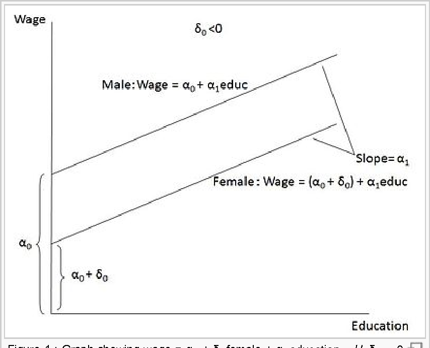
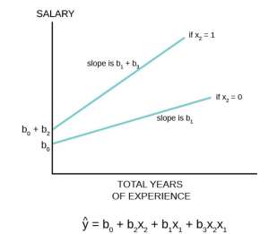

Vamos iniciar o estudo de modelos lineares começando pela Regresão Linear Simples (RLS). Mais específicamente, vamos estudar a RLS no contexto de dados de corte transversal. Tal abordagem, segmentada por tipos de dados, facilíta o entendimento das hipóteses do modelo.

Os conceitos estatísticos aplicados no estudo de RLS são os mesmos apresentados na seção anterior.

O matérial desta seção é baseado na 4ed do livro de Jeffrey Wooldridge, Introdução à Econometria: Uma Abordagem Moderna, de 2013. Embora o título do livro remeta à econometria, os modelos apresentados no livro são aplicaveis à diversas Ciências Sociais, tais como o Direito, Ciência Política, Sociologia, Psicologia Empírica etc...

A análise de Regressão é um instrumento poderoso para os centistas sociais. Podemos verificar como determinadas variáveis importantes nas ciencias sociais interagem com outras, as vezes em uma relação de causa e efeito.

Aqui também teremos que ter uma questão ou problema. Anteriormente gostariamos de entender o que estava acontecendo, qual a Renda pc das mulheres, qual a taxa de feminicídio... Agora queremos ir mais a fundo, porque determinados bairros tem mais crime do que outros? O que determina a renda pc de uma mulher?

## Introdução

Começamos com o modelo mais geral da população:

$$y = \beta_0 + \beta_1x + u $$

Nesta equação, $y$ é a variavel dependente ou também denominada de variável explicada; $x$ é a variável explicativa e $u$ é o termo de erro. Essa equação é uma equação de **regressão linear simples**.

**Vejamos um exemplo**

Gostariamos de explicar a taxa de crimes nos bairros de uma cidade e consideramos que os níveis de desemprego nas localidades são importantes. Nosso modelo de regressão poderia ser específicado da seguinte maneira:

$$Crime_i = \beta_0 + \beta_1Desemprego_i + u$$

O subscrito $i$ se refere a um bairro hipotético da cidade. Note que nesse caso, $i$ é o subscrito que relaciona nossas unidades de observação (bairros). Nossas unidades de observação podem variar a depender do contexto em estudo: países, cidades, bairros, estados, pessoas, processos, varas, tribunais....

Note que, novamente o termo de erro, $u$, está presente na equação. O termo de erro, não observado, capta tudo aquilo que afeta $Crime$, mas que não estamos controlando, ou seja, que não é explicado pelo $Desemprego$.

Voltemos a equação básica:

$$y = \beta_0 + \beta_1x + u $$

Na análise de RLS estamos interessados nos parâmetros $\beta_0$ e sobretudo $\beta_1$. A razão primordial para isso é que, tudo o mais constante, a relação acima aponta que

$$\Delta y = \beta_1 \Delta x $$ , se $$\Delta u = 0$$

Isto é, se tudo o mais que afeta $y$ permanecer inalterado, uma variáção em $x$, $\Delta x$, terá um impacto de $\beta_1 \Delta x$ em $y$. No exemplo da criminalidade, teremos que:

$$\Delta crime = \beta_1 \Delta desemprego $$

Assim, o aumento de 1 ponto no desemprego irá ter o efeito de $\beta_1$ unidades de crimes em média. Por isso, quando conseguimos estimar os parêmetros $\beta$ estamos mais próximos de entender as relações entre $x$ e $y$ em nossas aplicações.

Cabe destacar algo bastante importante.As relações acima não encerram a questão da causalidade. Como podemos inferir um impacto causal do desemprego na criminalidade se estamos ignorando todos os demais fatores que ficaram de fora do modelo - fatores que são captados em $u$ não observados.

### Alguns Exemplos de Regressão Aplicados ao Contexto Jurídico:

Considere os seguintes exemplos de RLS aplicadas ao contexto do Direito

[**Previsão de Sentenças com Base na Gravidade do Crime:**]{.underline}
 
  * **Variável dependente $(Y)$**: Tamanho da pena, 
  * **Variável independente$(X)$**:  Gravidade do Crime, 
  * **Objetivo**: Identificar se a gravidade do crime tem influência sobre tamanho da pena.
  
  Nesse exemplo $\beta_0$ é o intercepto da regressão e $\beta_1$ o coeficiente de regressão que representa como a gravidade do crime influência o tamanho da pena, $u$ é o termo de erro.

$$Dpena = \beta_0 + \beta_1{\text{Gravidade}} + u$$

[**Análise de Fatores que Influenciam o Tempo de Julgamento:**]{.underline} 
 
  * **Variável Dependente ($Y$)**: Tempo de Duração do Processo 
  * **Variável Independente ($x$)**, Tipo de Processo (por exemplo, criminal, civil, administrativo).
  * **Objetivo**: Identificar se o tipo de processo tem impacto no tempo que um caso leva para ser concluído.

$$Tempo = \beta_0 + \beta_1  Processo  + u$$

[**Previsão de Probabilidade de Recurso com Base em Decisões Anteriores:**]{.underline} 

  * **Variável Dependente ($Y$)**: Probabilidade de Entrada com Recurso
  * **Variável Independente ($X$)**: Resultado da Decisão Anterior (por exemplo, deferimento ou negação do recurso). 
  * **Objetivo**: Determinar a probabilidade de um recurso ser apresentado com base no resultado de decisões passadas.

$$Recurso = \beta_0 + \beta_1 Resultado_{-1} + u $$

[**Análise de Relação entre Número de Testemunhas e Veredito:**]{.underline} 

  * **Variável Dependente ($Y$)**: Veredito (por exemplo, culpado ou inocente)
  * **Variável Independente ($X$)**: Número de Testemunhas. 
  * **Objetivo**: Investigar se o número de testemunhas influencia a decisão.

$$ Veredito = \beta_0 + \beta_1 Testemunhas + u $$

## Hipóteses sobre o comportamento do Termo de Erro

Se especificamos o modelo com $\beta_0$, podemos assumir que $u$, tem média igual a zero. Em notação de esperança matemática essa hipótese equivale a:

$$E(u) = 0$$

Podemos definir uma segunda hipotese sobre $u$. Uma hipótese forte, é a de que $u$ e $x$ são independentes. Tal hípótese é crucial do modelo de RLS:

$$E(u|x) = 0$$

Justas as hipóteses de $E(u) = 0$ e $E(u|x) = 0$ são denominadas de hipotese de média condicional zero.

Dessa forma, no nosso modelo inicial:

$$y = \beta_0 + \beta_1x + u$$

Aplicando o operador $E( \cdot |x )$, obtemos

$$ E( y |x ) = \beta_0 + \beta_1x $$

Assim, na equação acima, temos um aumento de uma unidade em $x$, implica em um aumento no valor esperado (ou em média) de $y$ na magnitude de $\beta_1$.

A equação acima, é caracterizada como **função de regressão populacional**. Essa função nos fornece a relação entre os diferentes níveis de $x$ é o nível médio de $y$, isto é $E( y |x )$.


Agora, podemos voltar a nossa equação base e verificarmos o progresso feito no entendimento do modelo:

$$y = \beta_0 + \beta_1x + u $$

$$y = E( y |x ) + u $$

Na equação acima, $E( y |x )$ é chamada de parte sistemática de $y$. Isto é, a parte sistematicamente explicada por $x$. Já o termo de erro não observado, $u$ é a parte não sistemática de $y$, não explicada por $x$.


## Estimação dos Parâmetros da RLS

Não conhecemos $\beta_0$ e $\beta_1$ queremos estimadores desses parametros: $\hat{\beta_0}$ e $\hat{\beta_1}$.

Suponha que tenhamos uma amostra aleatória da população: $\{(x_i, y_i): i = 1, ..., n\}$. Poderia ser uma amostra de crimes e taxa de desemprego por bairros.

Em nosso modelo base:

$$y_i = \beta_0 + \beta_1x_i + u_i $$

onde $u_i$ é o erro aleatório da $i$-ésima observação.

[**Como estimamos** $\beta_0$ e $\beta_1$?]{.underline}

Após algum esforço algébrico, tem-se:

$$\hat{\beta}_0 = \bar{y} - \hat{\beta}_1 \bar{x}$$

e

$$\hat{\beta}_1 = \frac{\sum_{i=1}^{n} (x_i - \bar{x})(y_i - \bar{y})}{\sum_{i=1}^{n} (x_i - \bar{x})^2}$$

Onde, $\bar{x}$ e $\bar{y}$ são as médias amostrais de $X_i$ e $Y_i$, respectivamente.

Os estimadores $\hat{\beta}_0$ e $\hat{\beta}_1$ são chamados de estimadores de Mínimos Quadrados Ordinários (MQO).

A ideia é que os parâmetros que estimamos, $\hat{\beta}_0$ e $\hat{\beta}_1$, são os parâmetros que minimizam a soma dos quadrados das diferenças entre nossos $y_i$ observados e seus **valores preditos** definidos como

$$y_i- \hat{y}_i =y_i -  \hat{\beta}_0 + \hat{\beta}_1x_i=u_i$$ 

Queremos minimizar o quadrado dessa diferença. Vejamos graficamente:


Antes de passarmos para o proxímo tópico de RLS, cabe mencionar uma nota sobre terminologia: quando estimamos equações de RLS do tipo $y = \beta_0 + \beta_1 x + u$, dizemos que "*rodamos a regressão de* $y$ sobre $x$ !"


### Teste de Hipótese sob um Único Parametro
 
Agora precisamos testar se nossa estimativa é estatisticamente igual a zero ou se ela é diferente de zero. 

*Há evidências que a nossa variável $X$ afeta a nossa variável $Y$ na população?*

Na maior parte do tempo testamos hipóteses do tipo 

$$H_0: {\beta_j}=0$$
Na hipótese principal testamos a situação que $X$ não afeta $Y$ na população sob análise. Na hipótese alternativa: 

$$H_1: \beta_j \neq 0$$

Testamos a hipótese que $X$ afeta $Y$ nessa população. Graficamente temos a figura abaixo onde a média populacional é igual a 0: 


**Estatística de Teste**: 

Este é um valor calculado a partir dos dados da amostra que é usado para avaliar a probabilidade de observar tal valor se a hipótese nula fosse verdadeira ($H_0: {\beta_j}=0$). Ele que vai dizer se estamos na área amarela ou azul da figura acima. 


#### Valor-p: 

**O valor-p** é a probabilidade de observar uma estatística de teste tão extrema quanto, ou mais extrema do que, aquela calculada a partir dos dados da amostra, sob a suposição de que a hipótese nula seja verdadeira. Em outras palavras, mede quão provável é obter os resultados observados se a hipótese nula for correta.

**Interpretação**: Um valor-p pequeno (tipicamente menor que um nível de significância predefinido, comumente 0,05) sugere que os dados observados são improváveis de ter ocorrido se a hipótese nula fosse verdadeira. Portanto, fornece evidências contra a hipótese nula, e os pesquisadores podem rejeitar a hipótese nula em favor da hipótese alternativa. Por outro lado, um valor-p grande indica que os dados observados são consistentes com a hipótese nula, e as evidências evidências são insuficientes para rejeitá-la.


### Aplicação - Estimando uma Regressão Linear Simples

Vamos utilizar aqui o nosso banco de dados anterior sobre feminicídio. É um banco com poucas obserações e possui fim didátco, apesar de serem dados reais.

Uma questão incial é entender quem será $Y$ e quem será $X$. Estamos querendo entender a taxa de feminicídio. A questão é, quais são seus determinantes? Aqui precisamos de alguma teoria...mas por hora, vamos ter como hipótese inicial que quanto maior a taxa de homícídio (ou maior a violência no estado) espera-se que em média a taxa de feminicídio aumente:

$$Feminc_{tx} = \beta_0 + \beta_1 Homici_{tx} + u$$

Apesar de parecer "muito complicado" na teoria, na prática o `R` estima uma RLS em segundos. A função para estimar é a`lm`, ou linear model.

```{r}
### Aplicação da RLS - Método dos Mínimos Quadrados Ordinários

#carregando o pacote para ler arquivos em excel
load("../dados/final_fem_22.Rdata")

#Vamos chamar a partir de agora nosso banco de dados
dados<- final_fem_22 

##Função para rodar a regressão
modelo <- lm(data = dados, feminic_tx ~ homic_tx)


#Essa função resume a regressão, ja testar a hipótese sobre o coeficiente e da outras estatisticas que abordaremos a seguir.
summary(modelo)

```

#### Entendendo os Resultados

**1. Resíduos** (*Residuals*): apresenta a  distribuição dos resíduos, observa-se que a mediana dos resíduos está próxima a zero.

**2.Coeficientes** Em seguida, abaixo tem-se *Coefficients* com 5 colunas.

*Coluna 1*: Nome da variável

*Coluna 2*: Coeficiente estimado $\hat{\beta_0}$ o intercepto e $\hat{\beta_1}$ do termo da variável homicídio

*Coluna 3*: É o desvio padrão da estimativas de $\beta$

*Coluna 4*: É a estatistica `t` utilizada para fazer o teste de hipótese e neste caso, tem-se: $$H_0:\beta_0=0$$ 
$$H_1:\beta_0 \neq 0$$ 
e 
$$H_0:\beta_1=0$$
$$H_1:\beta_1 \neq 0$$ 

*Coluna 5*: É o p-valor, a probabilidade de encontrarmos valores mais extremos da estatística t. Os asteriscos indicam \*\*\* signicante a 0,1%; \*\* a 1%; \* a 5%; e $.$ a 10%.

**[Interpretando o Coeficiente]{.underline}**

O coeficiente do intercepto nos diz que quando a taxa de homicídio for 0, ainda existira uma taxa de feminicídio de 1,14 pontos  ($\beta_0$), sendo significante a 0,1%. E cada 1 ponto de aumento na taxa de homicídio, aumenta em 0,106 ($\beta_1$) pontos a taxa de feminicídio, significante a 10%.

**3. $R^2$**: Em seguida temos o $R^2$ e $R^2$ ajustado. Essas estatísticas calculam quanto da variância da taxa de feminicídio pode ser explicada pela variância da taxa de homicídio. Quando estão próximos a 1 explicam muito, quanto estão próximos a 0 explicam pouco. No caso o nosso $R^2$ ficou baixo e portanto boa parte da variabilidade do feminicídio, não foi explicada pela taxa de homicídio. 

**4. Estaística F**: E por fim a estatística F mostra o grau de ajustamento do modelo. Se ela for significativa diz que o modelo é bem ajustados aos dados. As variáveis explicativas incluídas são importantes para a explicação da taxa de feminicídio.Essa estatística testa a seguinte hipótese.

$$H_0:\beta_1=...=\beta_k=0$$
contra 

$$H_1: H_0\text{ é falsa}$$


**VISUALMENTE**

Abaixo tem-se os dados utilizados e a nossa reta de regressão estimada acima. Veja como ela se ajusta a nuvem de pontos. 

```{r}

# Ajustando a reta de regessão.
 plot(dados$homic_tx, dados$feminic_tx,
     main = "Taxa de Feminicídio vs.Tx de homicidio",
     xlab = "Taxa de Homicidio",
     ylab = "Taxa de Feminicídio",
     col = "steelblue",          # Cor dos pontos
     pch = 16,              # Forma dos pontos (círculos sólidos)
     cex = 1.0,         # Tamanho dos pontos
     abline(modelo, col = "lightsalmon3", lwd = 3))

```

## Caracteristicas do Método dos Mínimos Quadrados Ordinários em Determinadas Amostras de Dados

### Valores Estimados e Resíduos

Uma vez estimados $\hat{\beta}_0$ e $\hat{\beta}_1$ temos os valores ajustados ou também denominados de valores preditos ou *fitted values*.

Para uma observação qualquer $i$, seu valor estimado é:

$$\hat{y}_i= \hat{\beta}_0 + \hat{\beta}_1x_i$$

Todos os valores $\hat{y}$ estarão sobre a reta de regressão.

O resíduo, tal qual definido anteriormente, será a diferença entre o valor ajustado $\hat{y}$ e o verdadeiro $y$ em nosso banco de dados:

$$\hat{u}_i = y_i - \hat{y}_i$$

Se $\hat{u_i} > 0$ a regressão subestima $y_i$. Se $\hat{u_i} < 0$ a reta superestima $y_i$. O cenário ideal é quando $\hat{u}_i= 0$, algo que quase nunca acontece.

```{r}
##Obtendo os residuos da regressão
resid <- residuals(modelo)
 k <- density(resid)
  plot(k, xlab="Erro",main="Densidade de Kernel para o erro")
  polygon(k, col="burlywood3", border="burlywood4")
```

### Propriedades Algébricas do MQO

(1) A Soma dos Resíduos é zero: 

$$\sum_{i=1}^{n} \hat{u}_i = 0$$

```{r}

sum(resid)


```

(2) A covariancia amostral entre a variavel explicativa e os resíduos é zero:

$$\sum_{i=1}^{n} x_i \hat{u}_i = 0$$

```{r}
#obtendo a variável x
x <- dados$homic_tx

#somando com os residuos
sum(x*resid)


```

(3) O ponto $(\bar{x},\bar{y})$ sempre estará sob a reta de regressão.

(4) A média dos valores estimados, $\bar{\hat{y}}$ é igual a média dos valores observados $\bar{y}$.

```{r}

#y dos dados 
y <- dados$feminic_tx
mean(y)

#y estimado
y_hat <- fitted.values(modelo)
mean(y_hat)

mean(y)==mean(y_hat)
```

(5) Note que as estimatvas de MQO decompõe $y$ em 2 partes: 1) os valores ajustados $\hat{y}$ e os resíduos $\hat{u}$.

(6) Os valores de $\hat{y}$ e $\hat{u}$ são não correlacionados na amostra!


### Qualidade do Ajuste

Nesta seção vamos responder a seguinte questão: "*Quão bem* $x$ explica $y$ ?"

Considere as seguintes definições

Soma dos Quadrado Totais (SQT):

$$\text{SQT} = \sum_{i=1}^{n} (y_i - \bar{y})^2$$

```{r}
# Calcular a média da variável dependente (feminic_tx)
media_feminic_tx <- mean(dados$feminic_tx)

# Calcular a Soma dos Quadrados Totais (SQT)
sqt <- sum((dados$feminic_tx - media_feminic_tx)^2)
sqt
```

Soma dos Quadrados Explicados (SQE):

$$\text{SQE} = \sum_{i=1}^{n} (\hat{y}_i - \bar{y})^2$$

```{r}

# Calcular a Soma dos Quadrados Explicados (SQE)
sqe <- sum((y_hat - media_feminic_tx)^2)
sqe
```

Soma dos Quadrados dos Resíduos (SQR):

$$\text{SQR} = \sum_{i=1}^{n} \hat{u}_i^2$$

```{r}
residuos_quadrados <- residuals(modelo)^2
sqr <- sum(residuos_quadrados)
sqr
```


O resultado mais importante é o seguinte:

$$SQT =  SQE + SQR$$ 

É apartir dessa iguadade que podemos mostrar algo sobre o ajuste dos MQO.

Dívidindo ambos os lados por $SQT$ teremos

$$1 = \frac{\text{SQE}}{\text{SQT}}  + \frac{\text{SQR}}{\text{SQT}}$$ 

Rearranjando os termos

$$R^2 = \frac{\text{SQE}}{\text{SQT}} = 1 - \frac{\text{SQR}}{\text{SQT}}$$

```{r}

#r-quadrado do modelo
r_quadrado <- 1 - (sqr/sqt)
r_quadrado


```

Novamente, o $R^2$ é a porcentagem da variação de y que é explicada por $x$. O valor de $R^2$ sempre estará na RLS entre $0$ e $1$.


## Unidade de Medida e Forma Funcional

### Unidade de Medida

Vejamos o efeito de mudanças na unidade de medida das variáveis na nossa regressão. 

  **1.** Se a variável dependente ($Y$) é multiplicada por uma constante $c$, então as estimativas do intercepto e da inclinação também serão multiplicadas por $c$. Vamos multiplicar por 10 e ver o que acontece:

```{r, warning=FALSE, message=FALSE}
library(dplyr)
dados <- dados |> 
  mutate(feminic_tx10 =feminic_tx*10 )

modelo1 <- lm(data = dados, feminic_tx10 ~ homic_tx)

summary(modelo)$coefficients

summary(modelo1)$coefficients

```

  **2.** Se a variável explicativa ($X$) é multiplicada por uma contante $c$, então o coeficiente de inclinação será dívido por $c$. Nada acontece com o intercepto. Vamos multiplicar agora a taxa de homicídio por 10

```{r}
dados <- dados |> 
  mutate(homic_tx10 =homic_tx*10 )

modelo2 <- lm(data = dados, feminic_tx ~ homic_tx10)

summary(modelo)$coefficients

summary(modelo2)$coefficients

```


  3. Se a variável explicativa ($X$) é dividida por uma constante $c$, então o coeficiente de inclinação é multiplicado por $c$. Nada acontece com a constante.


```{r}
dados <- dados |> 
  mutate(homic_tx_10 =homic_tx/10 )

modelo3 <- lm(data = dados, feminic_tx ~ homic_tx_10)

summary(modelo)$coefficients

summary(modelo3)$coefficients

```

::: callout-note
## Importante

O $R^2$ e os testes de hipótese não depende das unidades de nossas variáveis.
:::


## Incorporando não linearidades (nas variáveis!)

Vamos agora incorporar a não linearidade nas variáveis e ver como fica a sua interpretação. Abaixo tem-se uma tabela para interpretar os coeficientes e será explicada nos exemplos que virão a seguir. 


| Modelo | Dependente |  Explicativa | Interpretação de $\beta_1$     |
|--------------------|--------------|--------------|------------------|
| Nivel-nível | $y$     | $x$      | $\beta_1 \Delta x$     |
| Nível-Log   | $y$     | $ln(x)$  | $(\beta_1/100)\%$ $\Delta x$      |
| Log-Nível   | $ln(y)$ | $x$ | $\% \Delta y = (100 \beta_1) \Delta x$ |
| Log_log     | $ln(y)$ | $ln(x)$ | $\% \Delta y = \beta_1\% \Delta x$  |


### Modelo Nível-Nível

Esse é o modelo que fizemos anteriormente e nos diz que uma variação absoluta em $X$ terá um efeito de $\beta$ em Y. 


```{r}
modelo_nn<- lm(data=dados, dados$feminic_tx ~ dados$homic_tx)
summary(modelo_nn)$coefficients
```
O aumento de uma unidade na taxa de homicídio aumenta em 0,1058 a taxa de feminicídio. 


### Modelo Nível-log

Primeiramente vamos criar as variáveis em ln:

```{r}
dados$Lnfeminic_tx <- log(dados$feminic_tx)
dados$Lnhomic_tx <- log(dados$homic_tx)

```

O modelo Nível-Log considerá $Y$ no nível e $X$ no log. As variações relativas de $X$ implicam em variações absolutas constantes em $Y$.


```{r}
modelo_nl<- lm(data=dados, dados$feminic_tx ~ dados$Lnhomic_tx)
summary(modelo_nl)$coefficients
```

A variação relativa de 1\% na taxa de homicídio ($X$), aumenta a taxa de feminicídio em 0,00623 $(\beta_1/100)$ 


### Modelo Log-Nível

Nesse modelo $Y$ está em log e $X$ em nível. Variações absolutas em $X$ implicam em variações exponenciais de $Y$.

```{r}

modelo_ln<- lm(data=dados, dados$Lnfeminic_tx~ dados$homic_tx)
summary(modelo_ln)$coefficients

```


Para cada incremento adicional da taxa de homicídio, tem-se um incremento de 4,5\% na taxa de feminicídio $\% \Delta y = (100 \beta_1) \Delta x$. 

modelo_ll <- lm(data=dados, dados$Lnfeminic_tx~ dados$Lnhomic_tx)
summary(modelo_ll)$coefficients

### Modelo Log-Log

Nesse modelo tanto $X$ como $Y$ estão em log. Variações relativas em $X$ implicam em variações relativas em $Y$


```{r}
modelo_ll <- lm(data=dados, dados$Lnfeminic_tx~ dados$Lnhomic_tx)
summary(modelo_ll)$coefficients

```


Um aumento de 1\% na taxa de homicídios aumenta em 0,29\% a taxa de feminicídio nos estados brasileiros.


##  Regressão Linear Múltipla (RLM)

A RLM é uma extensão natural da RLS. Entretanto, ao invés de termos apenas uma variável explicativa podemos ter $k$ variáveis dependentes

$$y = \beta_0 + \beta_1 x_1 + \beta_2 x_2 + \beta_3 x_3 + \ldots + \beta_k x_k + u$$ A hípótese fundamental é a de que:

$$E(u|x_1, . . . ,x_k) = 0$$

Problemas que façam com que um dos $x_1, ...., x_k$ ser correlacionado com $u$,  invalida a hipótese acima. Tal hipótese implica em não viés do MQO.

###  Exemplos de Regressão Multipla no Contexto Jurídico

[**Determinação de Fatores que Afetam o Valor de Indenizações:**]{.underline}

 * **Variável Dependente ($Y$)**: Valor da Indenização.
 * **Variáveis Independentes ($X$)**: Idade da Vítima, Gravidade do Dano, Jurisdição. 
 * **Objetivo**: Analisar como a idade da vítima, a gravidade do dano e a jurisdição influenciam o valor das indenizações concedidas

$$Indenização = \beta_0 + \beta_1 idade+ \beta_2 Gravidade + \beta_2 Jurisdisção + u$$

[**Análise de Variáveis que Influenciam Taxas de Condenação em Casos Criminais:**]{.underline}

  * **Variável Dependente ($Y$)**: Taxa de Condenação.
  * **Variáveis Independentes($X$)**: Idade do Réu, Tipo de Crime, Local do Julgamento. 
  * **Objetivo**: Investigar como a idade do réu, o tipo de crime e o local do julgamento afetam a probabilidade de condenação.

$$Tx.Condenação = \beta_0 + \beta_1  idade  +  \beta_2 Local  + \beta_3  crime + u$$

[**Análise de Fatores que Influenciam a Taxa de Feminicídio:**]{.underline} 

  * **Variável Dependente ($Y$)**: Taxa de Feminicídio por 100.000 mulheres
  * **Variáveis Independentes ($X$)**: Taxa de Desemprego, Índice de Educação, Presença de Políticas de Proteção à Mulher.
  * **Objetivo**: Investigar como o desemprego, o nível de educação e a existência de políticas de proteção à mulher estão relacionados à taxa de feminicídio em diferentes regiões.

$$Tx.feminicidio = \beta_0 + \beta_1 desemprego + \beta_2 educ + \beta_3 política + u $$

### A Interpretação da Equação de Regressão de MQO

Tal qual no modelo de RLS, temos que:

$$\Delta y = \beta_1 \Delta x_1 + \beta_2 \Delta x_2 + ...+\beta_k \Delta x_k$$

O coeficiente $\beta_j$, com $j=1,...k$, mede o efeito do incremento de uma unidade de $x_j$ em $y$. Isso continua com a mesma interpretação para modelos que usam o log. 

Suponha que estejamos interessados no efeito de $x_1$. Podemos fazer o seguinte exercício: Tudo o mais constante qual o efeito de $x_1$ em $y$:

$$\frac{\Delta y}{\Delta x} = \beta_1 $$

Manter outros fatores fixos permite o cientista social, "mimetizar" um experimento, o qual é muito utilizado nas Ciências Naturais. Obviamente, isso não é tão simples assim. Entretanto, manter outros fatores fixos, e supondo que $$E(u|x_1, . . . ,x_k) = 0$$ , nos aproxíma de afirmações de cunho causal.


## Estimação dos k parametros na RLM

###  Estimadores de MQO

A mecânica para conseguirmos estimativas de $\beta_j$, fica uma pouco mais complicada. Felizmente, os *softwares*, tais como o `R`, fornecem essas estimativas com muita facilidade. Não obstante, convêm apresentar uma abordagem para o cálculo desses parâmetros. Utilizaremos álgebra de matrizes para mostrar um "algoritmo" para calcular esses $\beta_j$. Em verdade, esse é o algoritmo utilizado pela função `lm()` do `R` no computo dos estimadores.

Considere o modelo para a $i$-ésima observação

$$y_i = \beta_0 + \beta_1 x_{i1} + \beta_{2} x_{i2} + \beta_{3} x_{i3} + \ldots + \beta_k x_{ik} + u$$

como temos $n$ observações (tamanho de nossa amostra), podemos organizar esses valores em vetores e matrizes.


Assim, representamos o modelo de RLM da seguinte maneira:

$$\mathbf{Y} = \mathbf{X} \boldsymbol{\beta} + \mathbf{u}$$

Queremos encontrar um estimador de $\boldsymbol{\beta}$, que chamaremos de $\boldsymbol{\hat{\beta}}$. Esse estimador sera dado por:

$$\hat{\boldsymbol{\beta}} = (\mathbf{X}^T \mathbf{X})^{-1} \mathbf{X}^T \mathbf{y}$$

Onde $\mathbf{X}^T$ é a matriz transposta de $\mathbf{X}$, e $(\mathbf{X}^T \mathbf{X})^{-1}$ é a matriz inversa da seguinte multiplicação de matrizes, $(\mathbf{X}^T \mathbf{X})$

Esse vetor de estimativas irá nos fornecer os valores para os $\beta_j$, com $j=1,...,k$. 


###  Estimativas de MQO

Vamos analisar o efeito da taxa de homicídio e da renda per capita sobre a taxa de feminicídio. Ou seja:

$$Feminic_i = \beta_0 + \beta_1 Homic_{i} + \beta_{2} Rendapc_i  + u$$

```{r}
### Estimando uma regressão Linear Multipla

rlm <- lm(data = dados, feminic_tx ~ homic_tx + rendapc)

summary(rlm)

```


A leitura dos resultados é análoga ao que já fizemos anteriormente. O aumento de uma unidade na taxa de homicídio aumenta em 0,11 a taxa de feminicídio e é significante a 10\%. Veja o p-valor de 0.059. Entretanto, não há evidências de que a renda pc tem efeito sobre a taxa de feminicídio. 

Assim, estados mais violentos tendem a ter mais feminicídios. Entretanto, estados mais pobres e mais ricos possuem taxas similares de feminicídio. 


### Qualidade do Ajuste na Regressão Linear Multipla


Um fato importante sobre $R^2$ é que ele nunca diminui ao incluirmos variáveis no modelo. Isso decorre de propriedades algébricas desse indicador. Em nosso exemplo:

 * **Modelo somente com Homicídio**: $R^2=0,12$ 
 * **Modelo com Homicídio e Renda**: $R^2=0,14$
 
 Veja que o $R^2$ aumentou ao incluir a renda pc.  
 
Por isso, os softwares geralmente reportam uma outra estatística de ajuste o R-quadrado ajustado, $\bar{R}^2$:


$$\bar{R}^2 = 1 - \frac{(1 - R^2)(n - 1)}{n - k - 1}$$

O $\bar{R}^2$, tal como expresso acima conta com a presença do $R^2$ original, mas note que, no denominador estamos dividindo por $n-k-1$, onde $n$ é o tamanho da amostra em mãos, e $k-1$ se referem ao fato de termos $k$ variáveis explicativas e uma constante. Portanto, o $\bar{R}^2$, impões uma penalidade à inclusão de variáveis independentes em um modelo de regressão. No nosso modelo:


 * **Modelo somente com Homicídio**: $R^2=0,12$ e $\bar{R}^2= 0,094$
 * **Modelo com Homicídio e Renda**: $R^2=0,14$ e $\bar{R}^2= 0,069$
 

Podemos notar que a inclusão da renda pc contribui muito pouco para a explicação do modelo mas prejudicou as estimativas (menor grau de liberdade). Dessa forma observa-se que o $R^2_{ajust}$ ou $\bar{R}^2$ ficou menor. 

Não obstante, cabe destacar que um $R^2$ baixo não é uma evidencia definitiva contra nosso modelo. Em ciências sociais é comum verificarmos $R^2$ relatvamente pequenos. Isso significa que, embora coletivamente as variáveis explicativas não expliquem muito das variações de $Y$, é possível que as estimativas de MQO sejam efeitos parciais confiáveis- tudo o mais constante - de cada $X_j$ sobre $Y$.


### Uso de Variáveis Qualitativas na Análise de RLM 

O uso de variáveis binárias é a alternativa para utilizarmos variáveis qualitativas (discretas ou categóricas) no modelo de regressão. Dessa forma, variáveis que possuem categorias (homem/mulher; regiões, típo de homicídio). Considere os exemplos mencionados anteriormente.

[**Determinação de Fatores que Afetam o Valor de Indenizações:**]{.underline} 

  * **Variável Dependente $(Y)$**: Valor da Indenização.
  * **Variáveis Independentes $(X)$**: Idade da Vítima, Gravidade do Dano, Jurisdição. 
  * **Objetivo**: Analisar como a idade da vítima, a gravidade do dano e a jurisdição influenciam o valor das indenizações concedidas

$$Indenização = \beta_0 + \beta_1 idade+ \beta_2 Gravidade + \beta_2 Jurisdisção + u$$

[**Análise de Variáveis que Influenciam Taxas de Condenação em Casos Criminais:**]{.underline}

  * **Variável Dependente $(Y)$**: Taxa de Condenação.
  * **Variáveis Independentes $(X)$**: Idade do Réu, Tipo de Crime, Local do Julgamento. 
  * **Objetivo**: Investigar como a idade do réu, o tipo de crime e o local do julgamento afetam a probabilidade de condenação.

$$Tx.Condenação = \beta_0 + \beta_1  idade  +  \beta_2 Local  + \beta_3  crime + u$$

[**Análise de Fatores que Influenciam a Taxa de Feminicídio:**]{.underline} 
    
  * **Variável Dependente $(Y)$**: Taxa de Feminicídio por 100.000 mulheres.
  * **Variáveis Independentes $(X)$**: Taxa de Desemprego, Índice de Educação, Presença de Políticas de Proteção à Mulher. 
  * **Objetivo**: Investigar como o desemprego, o nível de educação e a existência de políticas de proteção à mulher estão relacionados à taxa de feminicídio em diferentes regiões.

$$Tx.feminicidio = \beta_0 + \beta_1 desemprego + \beta_2 educ + \beta_3 política + u $$

Em todos esses exemplos temos o que denominamos de **variáveis qualitativas**. No primeiro exemplo, gravidade e jurisdição não são quantificaveis. No segundo exemplo, o tipo de crime, e a localidade. Por fim, no último exemplo, a variável que indica ou não a presença de uma política pública de proteção a mulher também é qualitativa. 

Felizmente, isso não traz problemas adcionais a estimação de MQO. Pelo menos quando tais variáveis aparecem como variáveis explicativas. Mais a frente veremos o que acontece quando a variável dependente é do tipo qualitativa.

Duas coisas mudam quando temos as variáveis qualitativas como regressores:

  1. Em primeiro lugar temos que organizar essas informações no banco de dados de modo coerente.
  2. Em segundo lugar, a introdução de variáveis qualitativas muda a interpretação dos resultados.

Fatores qualitativos geralmente aparecem na forma de informações binárias, também denominadas,*dummy*.


::: callout-note
## Variável Binária ou Dummy:

É uma variável que assume o valor 1 se a "[condição occorre]{.underline}" e 0 caso o contrário.
:::
 


[**Exemplos:**]{.underline}

**O crime de feminicídio ocorreu na região central?** 
  * *Variável Binária*: `crime_centro` (exemplo de nome)
  * se sim, ela recebe o valor 1, 
  * se não ocorreu a variável recebe o valor 0. 
  
  Nesse caso teremos uma coluna em nosso banco de dados denominada `crime_centro`, na qual a linha recebe o valor 1 caso o crime tenha ocorrido no centro e 0 caso o contrário.

**O crime foi considerado grave?** 
  
  * *Variável Binária*: `cri_grav` (exemplo de nome)
  * Se sim, recebe o valor 1, 
  * caso contráriorecebe o valor 0.


**Outras binárias....**
  
  * 1 se mulher e 0 se for homem.
  * 1 se for autodeclarado não-branco e 0 se for branco
  * 1 se trabalha e 0 se não trabalha
  * 1 se feminicídio e 0 se não for feminicídio. 


Utilizar 1 ou 0 é, de fato, um criterio arbitrário, mas essa escolha reside justamente na vantagem de se capturar informações importantes que tornam a interpretação dos resultados mais simples.

As observações que receberam 1 como valor serão comparadas com aquelas observações que ficaram com o valor 0. Essas observações seriam nosso "grupo de comparação/grupo base". 


####  Uma única Variável Dummy Independente

A forma mais simples de incorporar uma variável qualitativa e simplismente adicionarmos a variável binária na equação de regressão. 

Considere o exemplo prático retirado do livro do Wooldridge. Queremos entender os determinantes dos salários. Obviamente, o exemplo é bastante simples, mas será útil para avaliarmos a questão.


$$salario_h = \beta_0 + \delta_0 feminino + \beta_1 educ + \beta_3 exper + \beta_4perm + u $$
Nesse exemplo, estamos tentando entender os quais os fatores que afetam os salários dos indivíduos. O salário pode ser explicado pela educação, experência, tempo no cargo e pelo fato de ser mulher. A variável feminino assume o valor 1, se o individuo for do sexo feminino e 0, caso o contrário. Na equação $\delta_0$ mede a diferença no salário entre homems e mulheres, dado os mesmos anos de estudos, experiência e tempo no cargo, e evidentemente o mesmo $u$.

```{r eval=FALSE}
install.packages("wooldridge")
```

```{r, warning=FALSE, message=FALSE}
library(wooldridge)

data(wage1, package= "wooldridge")

wage_f<-lm(wage ~ female+educ+exper+tenure, data=wage1)
summary(wage_f)

```

O coeficiente estimado para a binária que identifica mulheres foi de -1,81 e significativa a 1\%. Isso indica que em média, uma mulher ganha menos US$ 1,81 por hora do que um homem com a mesma educação, experiência e tempo no cargo. 

Veja a figura abaixo ela mostra o efeito da binária feminina. Note que para um mesmo nível de escolaridade, o salário do homem é maior do que o salário da mulher. A dummy "desloca" o intercepto. 





Podemos utilizar a binária para ver o efeito da experiência para homens e para mulheres. Podemos fazer isso criando uma variável que é a multiplicação entre experiência e feminino. Vejamos: 

```{r}

wage1$exp_f<-wage1$exper*wage1$female


wage_f_2<-lm(wage ~ educ+female+ exper+exp_f+tenure, data=wage1)
summary(wage_f_2)
mean(wage1$wage)
```

Nesse novo modelo temos agora a binária de mulher, female, que mostra que o fato de ser mulher diminui o salário em -US\$0,88. Veja que a média de salário é de US\$ 5,9. A queda representa 15\% a menos em relação ao homem. 

Com relação a multiplicação pela experiência, podemos assim analisar. Como a variável é 0 para homem, o efeito da experiência para os homens é o próprio coeficiente,  exper. Para cada ano a mais de experiência o salário do homem aumenta em US\$ 0,057. Para as mulheres é a soma do coeficiente, exper + exp_f. Para cada ao a mais da experência da mulher o mercado paga US$0,001 . Isso está representado no gráfico abaixo.





### O uso de Dummies para categorias multiplas  e Interação entre a dummy e a variável dependente

Considere a equação abaixo considerando o mesmo banco de dados anterior: 

$$log(salarioh) = \beta_0 + \beta_1  hsolteiro  +  \beta_2 mcasadas  + \beta_3 msolteiras + \beta_4educ + \beta_5exper + \beta_6exper^2 + u$$
Agora vamos dividir entre homens e mulheres, casadas(os) solteiras(os). Note que definimos uma dummy para cada grupo e o grupo de comparação utilizaremos o grupo de homens casados.

As estimativas das dummies acima irão captar para cada grupo a diferença proporcional nos salarios-horas relativamente aos homens casados.

```{r}
###Aplicação de RLM multiplas dummies

data(wage1, package="wooldridge")


### criando as variáveis
library("dplyr")

wage1 <- wage1 %>%
  mutate(hcasado = ifelse(female==0 & married==1, 1, 0))

wage1 <- wage1 %>%
  mutate(mcasada = ifelse(female==1 & married==1, 1, 0))

wage1 <- wage1 %>%
  mutate(msolteira = ifelse(female==1 & married==0, 1, 0))

wage1 <- wage1 %>%
  mutate(hsolteiro = ifelse(female==0 & married==0, 1, 0))


status_civ <- lm(log(wage)~  hsolteiro + msolteira + mcasada + educ+ exper  +I(exper^2)+tenure, data=wage1)

summary(status_civ)


```

Como temos um modelos log-nível, a interpretação é dada por $\% \Delta y = (100 \beta_1) \Delta x$. Com base nas estimativas, verificamos que com relação aos homens casados:
  
  * *Homens solteiros* recebem cerca de 22\% a menos.
  * *Mulheres solteiras* recebem 32,6\% a menos. 
  * *Mulheres casadas* recebem 41,5\% a menos.
  
  Mantendo fixas educaçao, experiência e tempo no emprego. 


**Variáveis ao Quadrado: interpretando**

Note que temos uma nova variável, a experência, ao quadrado. A variável ao quadrado tenta capturar a seguinte ideia: se cada ano a mais de experiência sempre gera o mesmo incremento de salário, ou se recebe cada vez menos por cada ano a mais de experiência. Temos agora uma mudança de interpretação 

$$\frac{\% \Delta y }{\Delta x}= 100\beta_5 +200\beta_6exper  $$

Com base nas estimatvas: 

$$\frac{\% \Delta y }{\Delta x}= 100\times0,0297 +200\times -0,000592 \times exper$$

$$\frac{\% \Delta y }{\Delta x}= 2,97 -0,118 \times exper  $$
Vamos pensar em uma pessoa que tem 0 anos de experiência e adquire um ano. Logo:

$$\frac{\% \Delta y }{1}= 2,97 -0,118 \times 1 = 2,85\% $$
Ela ira receber 2,85\% a mais de salário devido a essa experiência adquirida. Vejamos agora uma pessoa com 9 anos e adquire mais um ano, vai para 10. Logo

$$\frac{\% \Delta y }{1}= 2,97 -0,118 \times 10 = 1,79\% $$
Esse ano a mais agora adicionou apenas 1,79\% no seu salário. Para finalizar vejamos de 24 para 25 anos de experiência

$$\frac{\% \Delta y }{1}= 2,97 -0,118 \times 25 = 0,02\% $$
Adiciona praticamente zero. E a partir desse ponto a adição será negativa, mais experiência terá menor salário. Assim o ponto de mudança será:

$$ 2,97 -0,118 \times exper = 0 \implies exper=\frac{2,97}{0,118}=25,16 $$
O salário vai aumentando até chegar a experiência de 25 anos, depois desse ponto o mercado tende a penalizar com salários menores quem tem mais experiência. 


### Incorporando Informações Ordinais com o uso de Variáveis Dummy.

Vamos agora entender a criação de binárias para variáveis com várias categorias. Um exemplo clássico de variável com diversas categorias é a região onde mora o indivíduo. Podemos ver isso no nosso banco anterior chamado `dados`:

```{r}
table(dados$regiao)
```

Temos que escolher uma região de comparação, por exemplo Sudeste. Assim, pode-se criar uma binária para o CO, uma para o N, uma para o NE e uma para o S. Veja o exemplo abaixo. 


```{r}

### criando as variáveis
library("dplyr")

dados <- dados %>%
  mutate(CO = ifelse(regiao=="CO", 1, 0))

dados <- dados %>%
  mutate(NE = ifelse(regiao=="NE", 1, 0))

dados <- dados %>%
  mutate(N = ifelse(regiao=="N", 1, 0))

dados <- dados %>%
  mutate(S = ifelse(regiao=="S", 1, 0))

```


Como esse banco é muito pequeno, vamos retomar o banco o Wooldridge `wage1`. Neste banco já está criada a variável de região sendo a região leste a de comparação. Vamos adicionar na regressão as regiões, sul, centro-norte e oeste. 


```{r}

reg_salar <- lm(log(wage)~  northcen + west+ south + female+ educ+ exper +tenure, data=wage1)

summary(reg_salar)

```

Observa-se no modelo acima que não há diferenças regionais importantes nos salários, quando controlamos para mulheres, educação, experiência e tempo no trabalho. 


